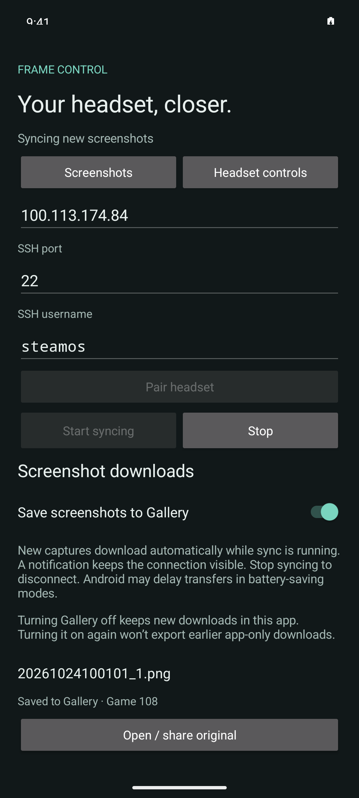
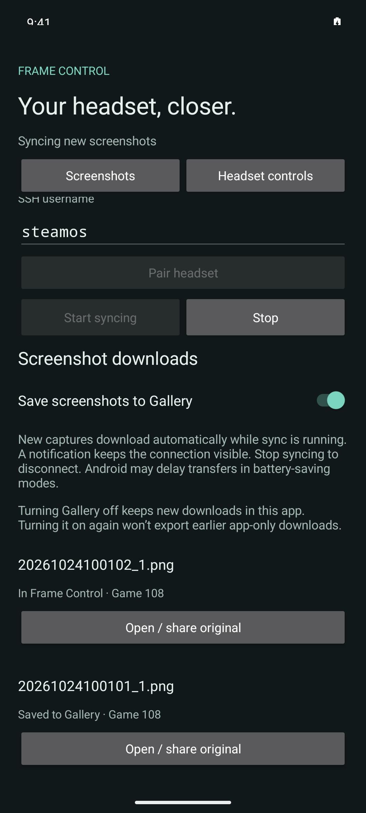
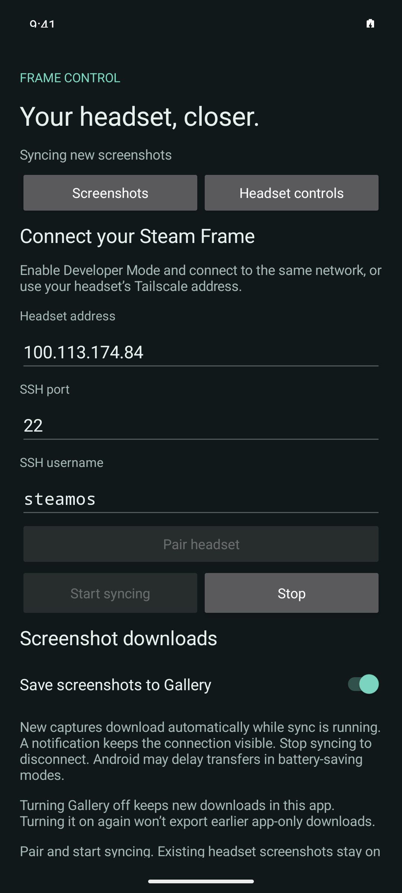
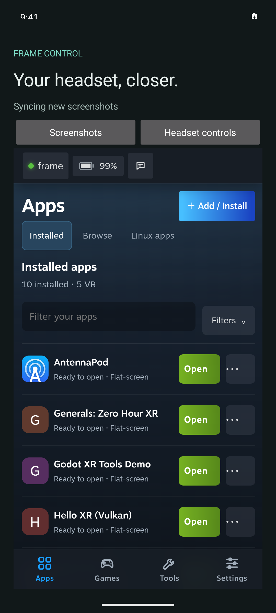

# Android phone screenshot sync evidence — 2026-10-24

Work: [#108](https://github.com/saphid/frame-control/issues/108). The user
authorized a new Android companion after the earlier APK could not be located.
This is a development build, not a production or Play release.

## Implemented

Native Android 10+ companion in `android/`, with pinned SSH transport and a
non-exportable Android Keystore phone key. Pairing checks the host fingerprint
before accepting a password and verifies key login before saving the pairing.
The shared headset server runs through a session-bound loopback tunnel.

All retained libraries receive Gallery opt-out, including previously paired
headsets. Paging keeps older offline originals reachable beyond the first 100.
A failed image or Gallery export retries independently without starving later
downloads; local persistence errors still halt immediately.

The user starts a connected-device foreground service with an ongoing Stop
notification. New screenshot originals download automatically. Gallery is ON
by default; turning it off latches pending and newly discovered items to
app-only, including across relaunch and later re-enabling. Historical captures
are baselined instead of imported. Receipts, original files, and MediaStore
recovery support interrupted downloads/exports without duplicate Gallery rows.

See [usage and background limits](../android-phone.md).

## Build and automated checks

- JDK 17, Gradle 9.4.1, AGP 9.1.0; compile/target API 36, minimum API 29.
- `assembleDebug testDebugUnitTest assembleDebugAndroidTest lintDebug` exited
  zero after review fixes: `/tmp/frame-108-android-build-final-r5.log`.
- 34 JVM sync-engine tests, zero failures/errors/skips. Tests cover baseline,
  stability, identity, metadata limits, destination latching, retries, atomic
  receipts, corrupt state, unsafe paths, late cancellation callbacks, per-item
  failure isolation and fatal persistence errors.
- API 36 arm64 emulator MediaStore tests passed: original byte round-trip,
  app-only across relaunch, interrupted pending row recovery and retry dedup.
  The final rebuilt APK passed **five selected native checks, no skips**:
  three MediaStore/multiple-library cases plus the actual headset fixture
  Gallery hash (`/tmp/frame-108-android-final-device-r4.log`, four tests), then
  app-only original/no-Gallery readback
  (`/tmp/frame-108-android-final-apponly-device-r4.log`, one test).
- Existing server suite: 1,333 tests, 11 skips, exit zero,
  `/tmp/frame-108-android-server-tests.log`. Website: 29 passed, zero skips,
  `/tmp/frame-108-android-site-tests.log`.
- Lint has no errors. Warnings include dependency/target freshness, English UI
  literals, backup-version compatibility, and the shared controls' JavaScript.

## Actual headset → Android emulator → Gallery

Target: task-owned headless API 36 emulator `emulator-5588`, with the actual
Steam Frame reached over SSH. Initial baseline contained nine historical
captures and imported none. An emulator-generated public test key was installed
temporarily through the existing trusted SSH alias; no password was exposed.
The unauthenticated native host-key probe matched the trusted headset key.

Synthetic fixture IDs use a separate test account/game namespace; this verifies
new-file delivery from the real headset, not the hardware capture shortcut.

| Check | Result |
| --- | --- |
| Gallery default ON | `999999999990/108/20261024100101_1.png` automatically downloaded and receipt became `saved` |
| Source / app / Gallery SHA-256 | `c9411d718c8a3477b7c7a6eed5ab827570605fce977bdeef5aaf11d29ba88316` |
| MediaStore dedup | Exactly one matching Gallery row; native test reads its original bytes |
| Shared headset controls | Actual authenticated WebView loaded the headset app library |
| Gallery OFF, app on Home | Second fixture automatically downloaded in 4.293 seconds (one synthetic trial) |
| App-only source / app SHA-256 | `6a1513b2dc3459b457f7dd86adcde7298d99dccc31c73904d7c6698703edb961` |
| App-only independent readback | One selected native test passed: correct app original and no matching Gallery row |
| Re-enable and restart | App-only receipt and absent Gallery row preserved; first image remains saved, no duplicate |
| Open/share original | Native chooser opened for the app-only original and was canceled; nothing sent |
| Final r5 APK, Gallery ON while Home | Third new fixture `999999999990/108/20261024101413_1.png` reached Gallery in 5.288 seconds (one synthetic trial); same source/app/Gallery hash as the first fixture, one matching row |

Background readback: `/tmp/frame-108-android-background-device-r1.log`.
Home was foreground with the app service active; the screen stayed on. This
is not a locked/Doze or long-duration physical-phone test.

The final r5 background Gallery readback passed separately (one selected native
test, no skip): `/tmp/frame-108-android-final-background-gallery-r5.log`.

Sanitized [machine readback](android-phone-screenshot-sync-2026-10-24/live-proof.json)
is committed; local full readback: `/tmp/frame-108-android-live-proof.json`. Fixture source
metadata: `/tmp/frame-108-android-fixtures.json`. The optional provisioning test
passed separately. Earlier full-class instrumentation runs included two
optional skipped hooks; those are not counted as four executed scenarios.

## Verification boundaries

No physical Android phone, Doze reliability, hardware screenshot latency,
password-pairing UI, Play signing identity or production upload has been
verified. Android sync uses an explicit foreground session, not Firebase.
The iOS foreground implementation has separate
[evidence](phone-screenshot-sync-2026-10-24.md); APNs, its delivery service,
notification extension and locked-phone Photos export remain unimplemented or
unverified. The user's full-feature tested-and-working release condition is
not satisfied.

T3's device tools incorrectly inferred the Android SDK from the platform-tools
Cask and could not open this emulator. The Astra worker used the app-owned
agent-device launcher with a task-local session/config and the correct SDK.
No global SDK/T3 settings or physical devices were changed.

UI verification: provider `codex`, model `gpt-6-astra`, completed task
`node:delegated-task:command%3Amcp%3Ad5d74833-0742-471e-af70-a23afbe44dab%3Adelegate-task%3Aframe-108-android-ui-astra-20261024-r1`.
Report: `/tmp/frame-108-android-ui-report.md`.

## Review and final artifacts

The APK is `android/app/build/outputs/apk/debug/app-debug.apk`, signed with the
development identity. No store upload or release has been performed.

Final r6 APK SHA-256: `e6a99a35154c21293975ea165eb967d8cc7ad84565f063255c3848ada1169f6e`.

Preferred different-model review (`claudeAgent` / `claude-opus-5-5`) failed
before work with `Claude API rate limit reached. Try again later.` Task:
`node:delegated-task:command%3Amcp%3Ad5d74833-0742-471e-af70-a23afbe44dab%3Adelegate-task%3Aframe-108-android-review-opus-20261024-r1`.
Implementation and independent fresh fallback reviews used Sol; they are not
different-model evidence.

Provider `codex_secondary`, model `gpt-6.1-sol`, high, completed round 1:
`node:delegated-task:command%3Amcp%3Ad5d74833-0742-471e-af70-a23afbe44dab%3Adelegate-task%3Aframe-108-android-review-sol-20261024-r1`.
All four findings were accepted and fixed: failed-item starvation, API-29
pending-row recovery query, opt-out for other retained headset libraries, and
inaccessible originals beyond the latest 100. Report:
`/tmp/frame-108-android-review-sol-r1.md`. No CODING_STANDARDS.md was found in
the task or primary worktree; CONTRIBUTING.md was included in review context.

Provider `codex_secondary`, model `gpt-6.1-sol`, high, completed round 2:
`node:delegated-task:command%3Amcp%3Ad5d74833-0742-471e-af70-a23afbe44dab%3Adelegate-task%3Aframe-108-android-review-sol-20261024-r2`.
It cleared all four prior fixes and independently reran 34 JVM tests, then found
a library-switch cache identity issue: matching receipt fields could retain a
Share action bound to the previous headset. The refresh signature now includes
the absolute original path, including the headset library root.

The final r6 build (`assembleDebug assembleDebugAndroidTest lintDebug`) exited
zero: `/tmp/frame-108-android-build-r6.log`. A new native regression launches
the real activity, switches between two libraries with matching receipt fields
but different original bytes, and verifies that Share now selects B’s bytes.
The chooser is intercepted; nothing is sent externally. This regression and
the three existing MediaStore/multiple-library cases passed together: **four
selected tests, no skips**, `/tmp/frame-108-android-final-device-r6.log`. Core
code is unchanged from the 34 independently passing JVM tests. The r6 change
does not alter the r5 transfer/storage path exercised against the real headset.

Provider `codex_secondary`, model `gpt-6.1-sol`, high, completed round 3:
`node:delegated-task:command%3Amcp%3Ad5d74833-0742-471e-af70-a23afbe44dab%3Adelegate-task%3Aframe-108-android-review-sol-20261024-r3`.
**No actionable findings** in the frozen 25-file executable target (`android/`
and `.github/workflows/android.yml`), with the remaining share-binding finding
resolved. All executable fingerprints stayed unchanged during review. Report:
`/tmp/frame-108-android-review-sol-r3.md`. The review inspected the passing r6
native/build logs and unchanged core covered by round 2’s independent 34-test
run; it did not claim new device runs or release validation.

Cleanup removed the one exact temporary public key and all three exact synthetic
headset fixture paths, verified absent. Other authorized keys and real captures
were preserved. Readback: `/tmp/frame-108-android-cleanup.json`. The task-owned
`emulator-5588` was shut down after the live tests, then restarted only for
the r6 share-binding regression and shut down again;
no other device was stopped. Build artifacts, the AVD and local test logs remain
available for follow-up verification.
