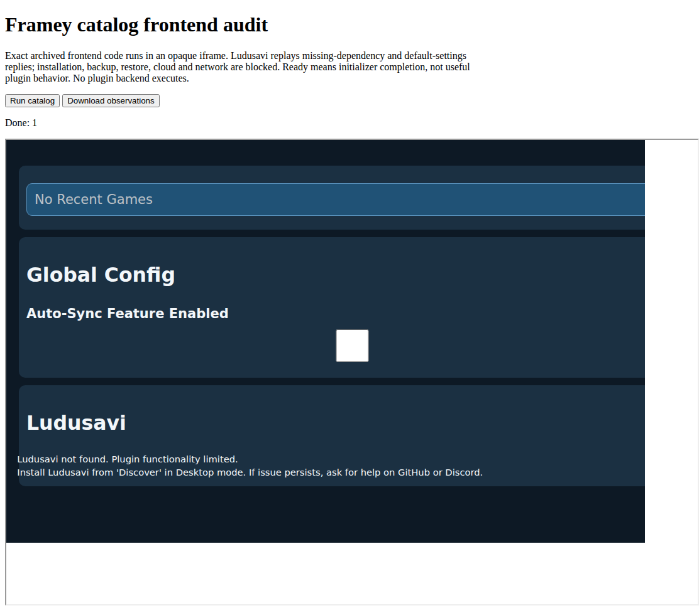

# Ludusavi dependency discovery — 2026-10-31

The exact official **Decky Ludusavi 1.2.2** archive (store ID 103, SHA-256
`8a69f45aadce763406b5c27bfef194761006d5e01c5e8841badeb13a27dd0d88`)
raises a version-query error when none of its three executable candidates exists.
Its helper never initializes `version` in that path. The exact managed copy now
initializes an empty version and resets the executable selection on each discovery,
limits each `--version` command to five seconds, and tries the next candidate after
a timeout. The original frontend can then show its existing missing-dependency
message. Only the exact helper/archive digest is adapted; all other archive members,
classification and installer policy are preserved. Existing copies need Update/reinstall.

## Native evidence

An isolated local AMD64 container ran the published, hash-pinned **Decky 3.3.0**
loader and its actual API1 RPC. It tested:

- All candidates absent: `get_ludusavi_version` returns
  `{"bin_path":null,"version":""}`.
- A private Python executable standing in for the first candidate sleeps beyond
  five seconds. Discovery kills/reaps that child, then selects a separate private
  CLI that accepts only `--version`. No Flatpak or real Ludusavi is invoked.
- The unchanged original helper, restored only in the disposable installed copy,
  reproduces the actual remote `AttributeError` as a negative control.
- Restoring the managed helper and removing the private executables returns the
  missing state after another loader restart. All four parent-only SIGTERM stops
  exit zero; owned descendants are reaped without group signals hiding a stall.

The [JSON record](framey-ludusavi-dependency-2026-10-31.json) retains all three
successful RPC results, the original remote failure, all ten installed-member
hashes, nine runtime-source fingerprints, clean-stop details and the complete
loader console. The console contains the deliberate original-regression error;
this is not an error-free-console claim. The test checks specific shutdown-error,
pending-task, cancellation and bad-file-descriptor markers separately.

Reproduce with:

```sh
python3 scripts/framey-test-decky-runtime.py --loader /path/to/PluginLoader \
  --case 103 --output /tmp/ludusavi-dependency.json
```

The native AMD64/ARM64 CI matrix includes the new case. This document qualifies
local AMD64 only; exact final-head hosted CI, ARM64, e2e and every triggered package
mode remain required before merge. The source revision and hashes are in the JSON.

## Frontend evidence

The exact original frontend rendered in an opaque `allow-scripts` iframe in local
sandboxed Chromium 156.0.8078.73. The opt-in `--ludusavi-missing-fixture` browser
audit supplies in-memory missing-version and default-setting replies, matching
the native missing-state result. The panel shows **“Ludusavi not found. Plugin
functionality limited.”** and the upstream installation guidance. Its initializer
completes; only `get_config` and `get_ludusavi_version` are requested. No button
was used to install software or change settings. Installation, backup, restore,
cloud and other backend calls remain denied by the fixture. Steam library and
running context stay unavailable and produce explicit audit warnings.



Browser renderers retain seccomp mode 2 and no-new-privileges, with ancestry to the
owned browser. The browser and audit server exit after capture. This replay does
not connect the frontend to the native backend.

## Limits and cleanup

Compatibility remains **partial**. No real Ludusavi binary, Flatpak installation,
backup, restore, cloud sync, game lifecycle, private save data, ARM64 backend,
real Frame, worn view or physical controller was exercised. Other asynchronous
command and unload behavior remains unverified; this change bounds dependency
version discovery only. Synthetic fixtures and transport tests do not establish
plugin usability in VR. The separate hourly headset schedule was unchanged.

The canonical native runner removes its owned containers and unique image tag.
The browser capture uses an owned temporary profile and copied browser runtime;
it does not change system browser installation or security settings. An old shared
Chrome package was truncated and could not be extracted; no result from that
attempt is qualified. A first frontend assertion incorrectly expected the internal
`MISSING` state as literal rendered text; the actual upstream text above was then
asserted and visually inspected. Earlier two-second native trials remain historical,
not proof of the final five-second implementation. Full real-device/release gates
remain required. No release is published by this PR.
