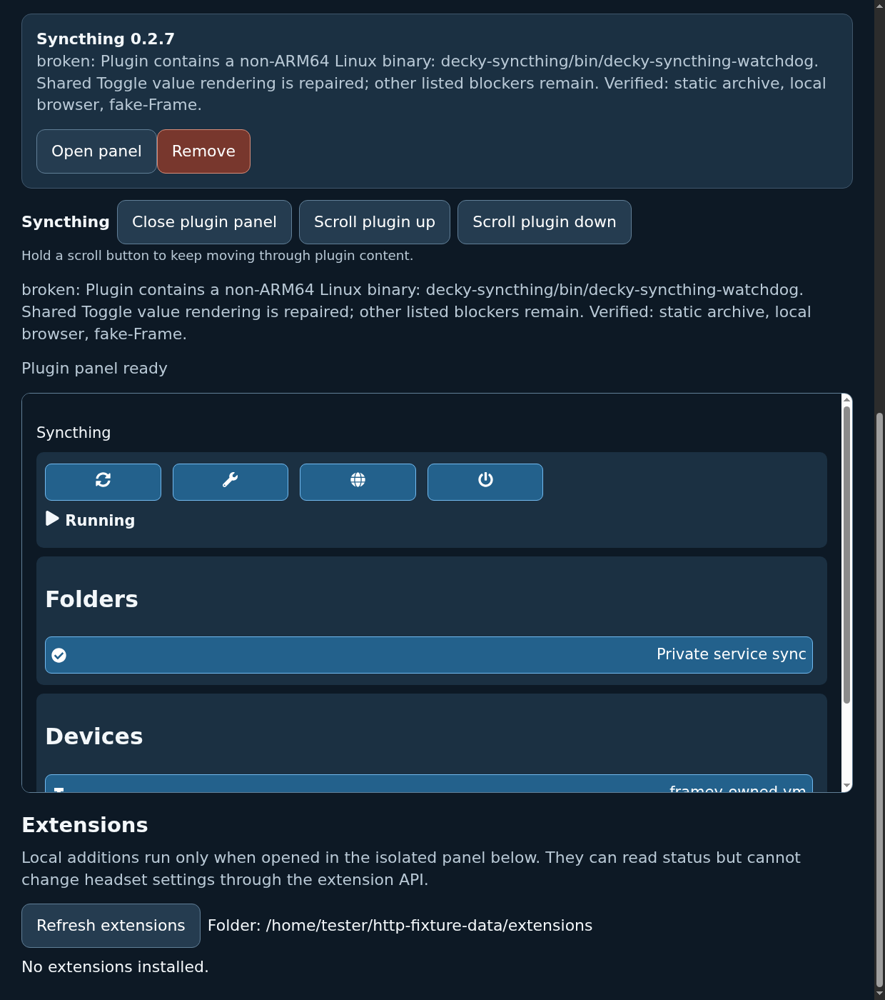
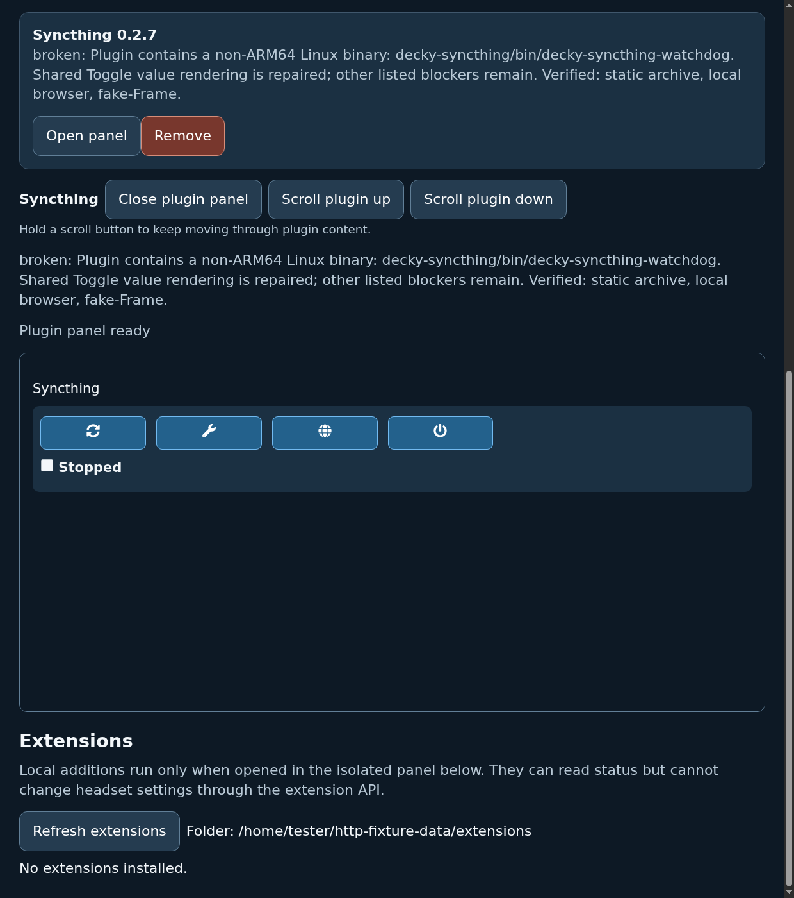

# Syncthing production-parent AMD64 replay12

The first strict full-parent local replay passed on 30 October 2026. The
production `/headset` page opened its actual opaque plugin panel, completed
setup, displayed populated Running, stopped, restarted with the same private
folder and devices, and stopped again. All eight parent/bridge PNGs were
independently decoded, hashed and visually inspected. The parent viewport
clips lower device rows; full stage DOM text and bridge captures show both.

This is historical local proof from private revision
`a4f37b6bbbcccce18088b2146d1edf42e3da6343`, with all 123 input source
fingerprints checked against that frozen tree. That revision is not published.
The companion JSON preserves the fingerprints, package identities, result and
console hashes, capture hashes, bounded budgets and audited outcome. This PR
is assembled on newer main and removes the unused import-profile diagnostic
mode. All 105 production UI source fingerprints are retained from the replay;
only the package driver and HTTP test fixture differ among its 123 inputs. It
requires fresh CI and runtime evidence for its own exact head.

The dashboard's five concurrent fetches formerly contended for the helper's
ownership lock. The receipt-bound Syncthing fetch bridge now runs one fetch
at a time, with at most 16 waiting. Queue time counts toward the existing
30-second total deadline. Cancellation removes queued work; an aborted active
fetch retains its slot until the backend settles. Panel receipt validation
uses the same fresh plugin scanner without unrelated service/CEF/OS probes.
No cache, retries, broader network access or larger RPC deadlines are added.

The networkless QEMU TCG guest used two CPUs, 8 GiB RAM and unchanged
install/user/unit/host limits of 300/1440/1500/1560 seconds. It ran the real
signed Syncthing package and actual Decky 3.3.0 user service through production
HTTP, panel dispatch and SSH method paths. All 64 parent HTTP calls returned
200. Fetch backend statuses were 200 (25), 204 (4), and 502 (10 during stopped
transitions); none was 500 or missing. One authenticated fixture CEF socket
completed 73 unique requests without rejection, timeout or overflow.

Signed content, actual sync, ownership refusals, signed PID transitions,
migration, certificate/data retention and preserving uninstall were audited.
The target, renderer sandbox, 65 bounded status observers, browser, HTTP server,
receipt, Decky service and QEMU cleanup were also audited. Import profiling
was disabled. Strict host checks reject visible `Error:` lines, loading-only
Running stages, backend 500s, reused main PIDs and incomplete cleanup.

## Limits

CEF and the store receipt are synthetic. This does not establish actual Steam
CEF, a managed install, ARM64 production-parent behavior, real Frame pixels,
wearer-visible UI or physical controller usability. Syncthing remains blocked
in the installer and compatibility policy. No headset was contacted and no
release was published. ARM64 browser bridge testing remains separate in #483.

## Captures

The companion JSON also identifies all four full bridge viewport captures.

## Published-candidate local validation

The local regression completed 1876 tests with 16 platform/optional skips and
zero failures in 228.227 seconds. The HTTP test module was also run separately
after restoring three readiness cases from newer main: all 32 cases passed.
The full run log SHA-256 is `3a510e61b8d882d8f22991abc18c6e73ea5f632268807da71954776f8d06f2ba`.
The Node fetch-queue harness, 30 panel tests, four Downloads tests, Python/JS
syntax, actionlint v1.7.11, exact-head manifest exercise and diff checks passed.
These local checks do not replace exact published-head CI/runtime evidence.
