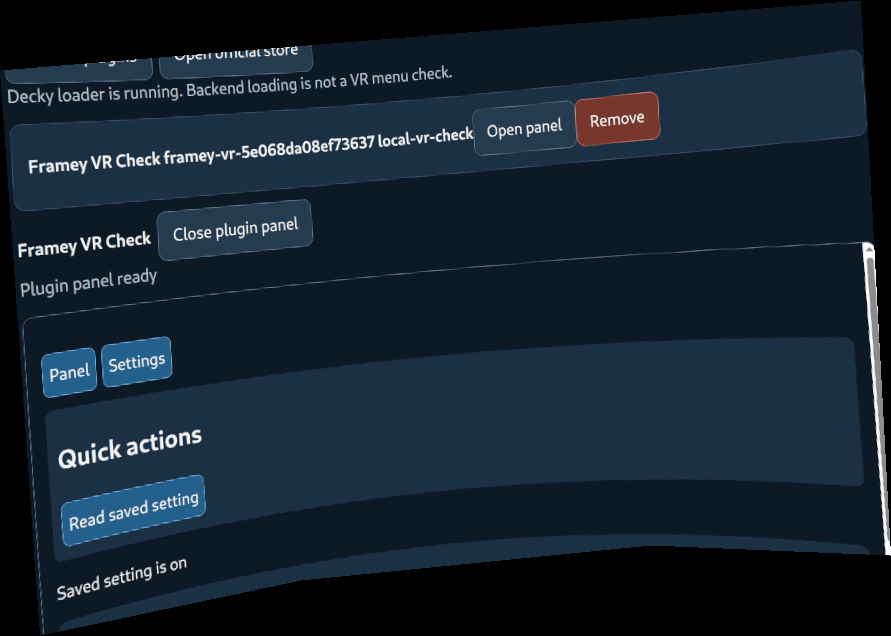
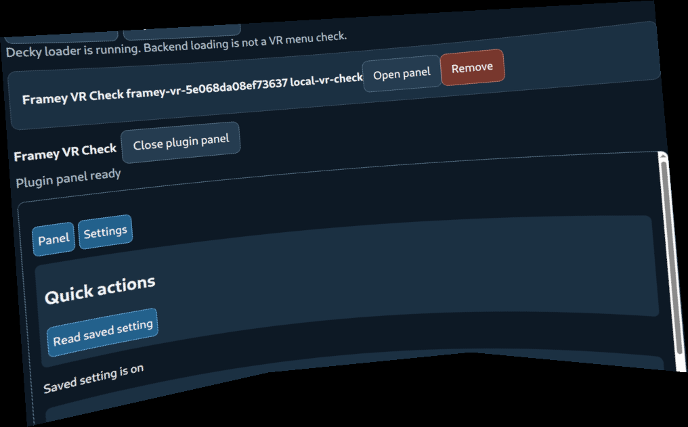

# Framey unattended VR evidence, 25 October 2026 UTC

The committed runner exited **0** on the real Frame, using the existing
`ssh lxso2 'ssh frame …'` route from lxso1. No person wore the headset.
Frame OS **0.5.6**, build **20261022.6153909**, ARM64, SteamVR **2.18.2**,
Decky **3.3.0**. The run began at **23:27:34 UTC**; the Frame's own clock/logs
use UTC+11 and therefore show 26 October.

```sh
python3 scripts/framey-vr-check.py --via lxso2 --exercise --output /tmp/framey-vr-verified
```

[Full machine result](result.json) records source commit
`cb9ad1b6cb7302008783d5f7fe42fa77a4dd43af`, bundle digest, before/after
SteamVR listings, power settings, input observations, and private image hashes.
The checked app code includes the sample settings-path and iframe-reopen fixes
and main through `d77e2bd`. This is source-bundle testing, not a newly published
release/AppImage test. The sample has a random test name and store-shaped local
receipt; it is not presented as an official catalogue listing.

| Check | Observed | Scope |
| --- | --- | --- |
| Overlay registration and visibility | `IVROverlay_027.IsOverlayVisible=true` | Actual Frame Control gamescope overlay, not a browser fixture |
| Transform | type **5**, DashboardTab; absolute getter returns **18**, WrongTransformType | Dashboard owns placement; no transform/dock setters used |
| Texture queries | main size 0×0; image read **24**, InvalidTexture | Direct texture refresh not established; compositor capture used instead |
| Stereo compositor | Before/after SHA-256 differ; final image visibly contains Framey tabs, quick action and saved result | Actual `IVRScreenshots_001` production screenshot path |
| OBS mirror | Current run's random name and “Saved setting is on” appear after draining 60 frames | `/dev/video99` pixels; OBS app itself was not launched in this task |
| OpenVR click | Move/down/up reaches intended control; iframe pointer event is trusted | `IVROverlayView_003.PostOverlayEvent`, no DOM `.click()` |
| Live setting | off → on; real backend file `{"enabled":true}`; fresh iframe reads on | Actual Framey HTTP → Steam CEF → Decky websocket → Python backend; no stubs |
| Tabs/quick action | Settings/Panel clicked; “Saved setting is on” returned | Actual shipped host controls and sample action |
| Slider | 10 → **50** | Native OpenVR click on actual DFL slider, diagnostic UI-only value |
| Text | **framey-ci** | OpenVR pointer focus, then CDP `Input.insertText`; not SteamVR keyboard proof |
| Smooth scroll attempt | `scrollBefore=0`, `scrollAfter=0` | No scrolling established by this attempt; do not count it as a pass |
| Battery | **99% → 99%** | Probed only under the owned lock |
| Power restoration | original pause **false**, timeout **5.000000**, exact values read back | Temporary values false/120; no idle-suspend timer or proximity changes |
| Cleanup | `cleanupErrors=[]`, `powerRecoveryRemoved=true`, `lockReleased=true` | Temporary managed services, sample/settings/profile, timer and restore script removed |

`IsDashboardVisible` and `IsActiveDashboardOverlay` are false while the panel is
visible in these captures: this is an existing placed/docked panel. They cannot
be used alone as a Framey visibility verdict. Activity changes from standby 3
to active 0 without wearing the headset, so activity alone is not worn proof.
Native OpenVR events also produce trusted pointers, so `event.isTrusted` alone
is not physical-controller proof. The worn script now requires explicit
`--worn-confirmed` and reports trusted pointer input with that narrower name.





These are inset panel crops from the raw captures, with all other pixels
replaced by solid black. No UI content was synthesized. [Image provenance](images.json)
contains source hashes, mask polygons, crops and published hashes. Raw images
remain private under `/tmp/framey-vr-verified` on lxso1. They are not committed.

## Bugs found and fixed

1. The author sample used `decky.decky_SETTINGS_DIR`, absent from real Decky
   3.3.0. The actual iframe displayed its backend `AttributeError`. Decky's
   [pinned module](https://github.com/SteamDeckHomebrew/decky-loader/blob/v3.3.0/backend/decky_loader/plugin/imports/decky.py)
   exports `DECKY_PLUGIN_SETTINGS_DIR`. The sample, docs and Python test fixture
   now use that name. The old fixture invented the same wrong attribute and
   masked the failure. The live fixed backend save/reopen is in `result.json`.
2. Reopening the same plugin changed only `#session`, so Chromium retained the
   old document/host/cache session. It could retain an error and eventually
   show a false “No compatible panel loaded” message. A fresh query parameter
   forces a new document while keeping the fragment session. The cache
   regression now checks document URLs, rather than manually assuming a new
   iframe. The real reopen with the saved setting passed.

## Methods tried and limits

Read-only `vrcmd` stats/overlay listings, the shipped OpenVR ABI, compositor
logs and actual CEF/Chromium targets were inspected first. A simple
`--handlewakeup` initially produced the Frame Control status panel in a stereo
screenshot. The full test uses a bounded screen timeout so it stays active.
Decky's service startup reloads Steam's web helper. During exploratory service
recreation, SteamVR logged `UpdateInputFocus: Failed to give focus to panel`
and returned a hidden, zero-sized main overlay despite a successful focus
request. Retagging only the test browser's `STEAM_GAME` property recovered it;
no Steam, SteamVR, gamescope or headset restart was needed. The final run did
not need this recovery. The runner records it when used.

The first mirror image was demonstrably stale: it contained a previous test's
random plugin name while the contemporaneous stereo image contained the current
one. Reading 60 frames before selecting the mirror image fixed that observation;
the final two published images contain the same current run name.

The diagnostic itself initially failed its cleanup check because an idle
systemd watchdog service was already unloaded. It restored power and removed
the test services, retained the lock, then the exact owned remainder was cleaned
up. Cleanup now checks `LoadState` and tolerates an already-unloaded transient
unit. Subsequent full runs, including the committed run here, exited 0 with no
cleanup errors. A four-minute power-recovery timer was created and cancelled;
forced host death or network loss was not fault injected.

A null driver or virtual tracked controller was not needed for pointer delivery
and was not installed. No root/system files, tracking/proximity configuration,
Steam global binaries, or spatial transforms were edited. PR #113 was untouched.
This check does not establish every official plugin, sustained frame rate,
backend persistence across Steam/Decky reboot, physical controller tracking or
haptics, a functioning virtual keyboard, native scrolling, comfort or legibility
through the optics. Follow the [three-minute worn checklist](../../framey-vr-check.md#three-minute-worn-checklist).

## Local checks

- Full Python suite after integrating current main and worn-confirmation gate:
  **1,595 tests, 16 skipped, OK**. The final added scroll/mirror helpers also
  passed the **24 focused Framey tests** and the real-device run above.
- App and website test commands passed under **Node 24.22.1**, matching CI's
  Node major. System Node 22 cancelled unrelated Meta sign-in timer tests;
  those files were not changed. Node 24 was used for final app verification.
- `git diff --check` and Python compilation passed. Hosted CI status belongs to
  the PR; local checks do not substitute for its macOS/Windows/ARM64 jobs.

A separate [locked cleanup audit](cleanup-verification.json) confirms both test
services inactive, no panel bundle or Decky binary, no test plugins/profiles or
remaining timers, power restored to false/5, battery 99→99, and its own lock
released. It also removed the stale DevTools discovery file created during the
earlier exploratory use of the original browser profile.
