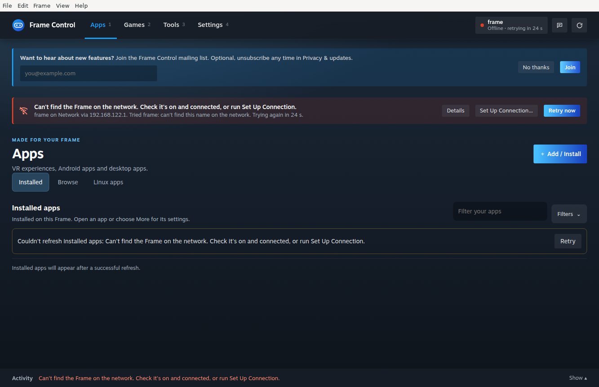
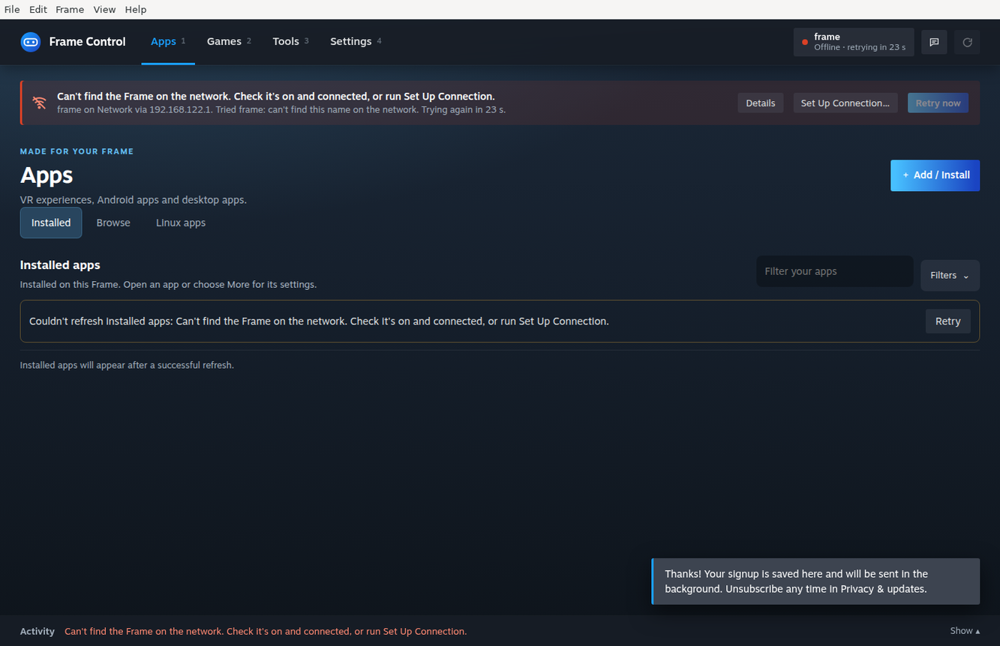
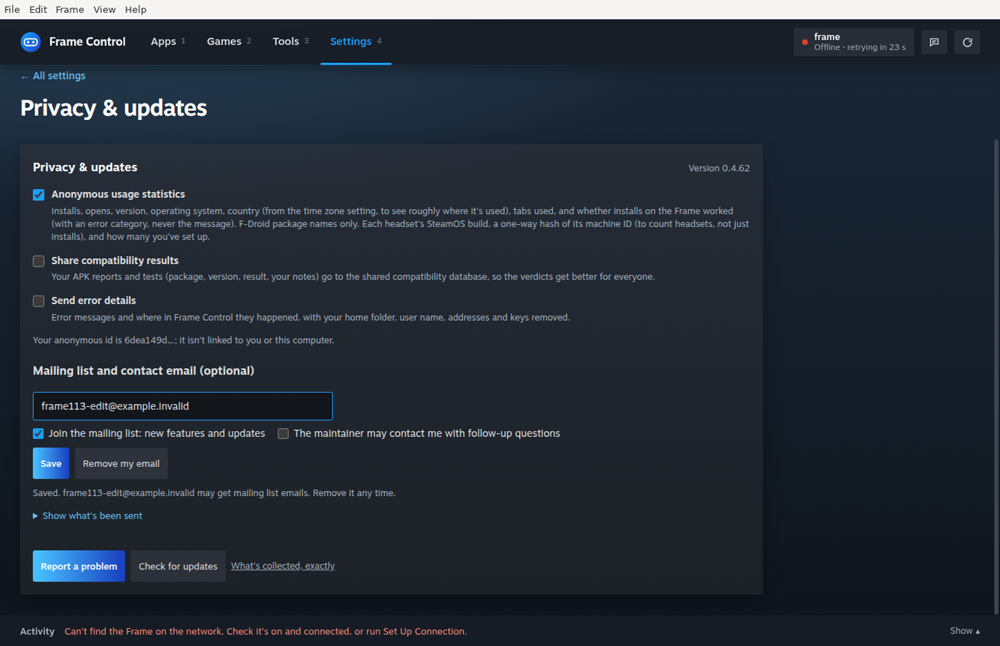
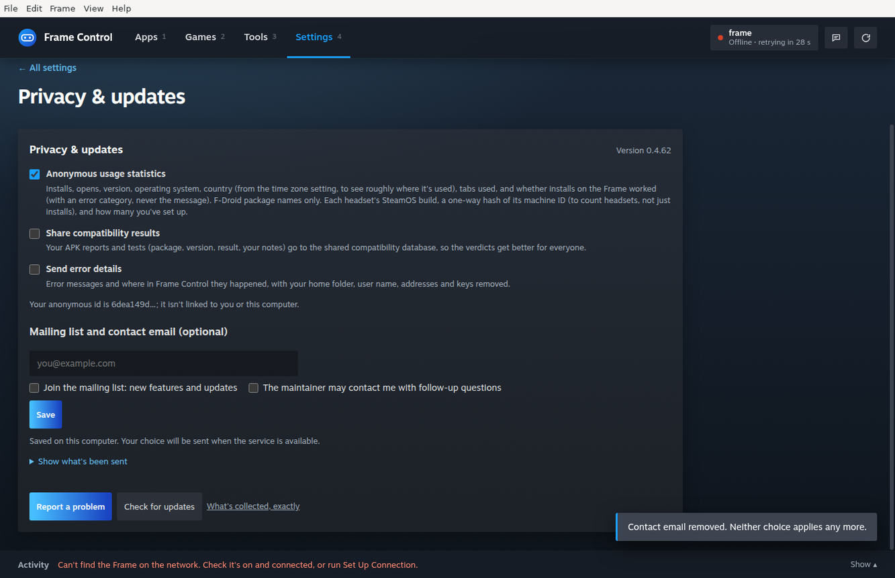

# Packaged optional mailing signup proof

[Frame #113](https://github.com/saphid/frame-control/pull/113), tested executable source `e2b0b159f4b82bc3bef5e494124ca0477a04a24c`, 14 November 2026.

A fresh private Linux x64 VM built the actual Electron directory package with `npm ci`, `node build/fetch-deps.js linux x64`, and `npm exec -- electron-builder --linux --x64 --dir --publish never`. Build exit: **0**. The packaged executable ran with its normal sandbox. Disposable profile/data paths and localhost mailing/telemetry endpoint overrides isolated the run. All email addresses are synthetic `example.invalid` addresses.

The privacy notice appeared before the empty optional mailing offer. **No thanks** survived restart and generated no mailing request. A second fresh profile successfully joined from the first-run offer. Help → Join the Mailing List opened Privacy settings and focused the email field. A later join delivered mailing-only opt-in, without follow-up consent. A forced localhost 503 retained an edited address as revision 2 in the durable mailing queue. Restarting with the sink restored delivered that same revision and drained the queue. **Remove my email** delivered the revision 3 tombstone, cleared the local email and choices, and left both queues empty.

`proof.json` contains the sanitized request timeline and artifact hashes. Main/preload bytes extracted from `app.asar`, and packaged UI/server/contact/mailing files match the tested source. Electron-builder normalizes packaged package metadata and omits the lockfile. The source-after-build manifest checked 2,229 source files without changes; two tracked example `dist` files were excluded by its filter and were not checked. The full private local receipt archive has SHA256 `bb94b21890a0335adffa752602ef07a09fe6238e4eb35a5c4b4a9d91dce50b33`.

This is Linux directory-package proof. Windows/macOS installers, real Steam Frame/headset behavior and hosted D1/backend topology remain untested. No D1 provisioning, deployment or newsletter send occurred. Apps quit cleanly; the stop request was accepted and the disposable sandbox was absent from the complete subsequent Boat list.
