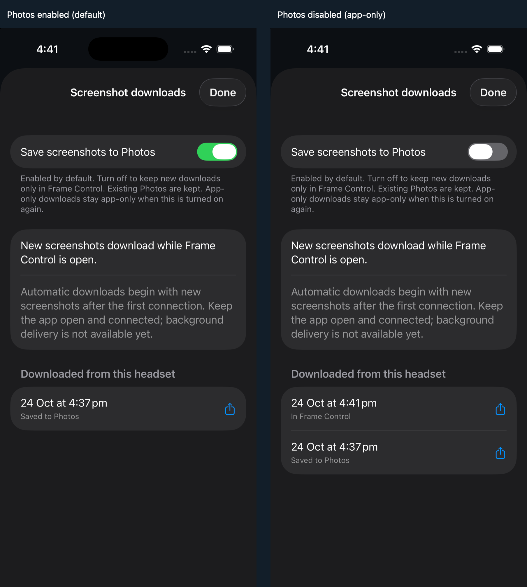

# iOS foreground screenshot downloads — 2026-10-24

This is implementation and proof for the foreground iOS portion of
[#108](https://github.com/saphid/frame-control/issues/108). It is not the full
requested background/cross-platform feature and is not released.

## Source and merge

Dedicated worktree: `/Users/saphid/.t3/worktrees/steam-frame/feat-phone-screenshot-autosync-108`.
Branch: `feat/phone-screenshot-autosync-108`.

First merged fetched main
[1d4c57d6](https://github.com/saphid/frame-control/commit/1d4c57d6)
into the existing Mac-space parent
[3fdc6c46](https://github.com/saphid/frame-control/commit/3fdc6c46).
Merge commit: [52772323](https://github.com/saphid/frame-control/commit/52772323).
The dirty primary checkout was left untouched. Review found and fixed the PC
helper's missing public route for the extracted `mac-stream.js` dependency.
Independent merge re-review ran 45 tests successfully, one skipped, and found
no remaining actionable findings in its seven-file target.

## Implemented behavior

- Native polling every four seconds while active, independent of the visible web tab.
- First successful listing becomes the durable baseline; only new captures queue.
- Two equal metadata observations, exact byte count and complete ImageIO decode
  precede an atomic original write outside purgeable caches.
- Receipts and originals distinguish pinned headset identity, Steam account,
  app ID and filename. Reconnect/relaunch resumes pending work.
- Photos is enabled by default. Add-only permission is requested in foreground.
  Denied/failed exports keep originals; app-only captures never automatically
  export after re-enabling the setting.
- Native downloads sheet exposes retained files through ShareLink, including
  during connection failure/relaunch. Ambiguous interrupted Photos commits need
  explicit recovery rather than risking an automatic duplicate.
- Backgrounding stops polling; no unrelated background mode is used.

## Automated verification

Normal signed Simulator build and full native test suite: **20 tests passed,
zero failures**, including eight screenshot tests. Result bundle:
`/tmp/frame-108-ios-all-r3.xcresult`; log: `/tmp/frame-108-ios-all-r3.log`.
Both command exit status and xcresult test count were checked. Private
DerivedData cleanup completed. Test target was the independently created
Simulator `F250F91E-2E7D-4833-B029-A275F11FDC7D` on iOS 26.5.

Screenshot tests cover baseline/stability, truncated data, restart dedup,
Photos failure/retry, changes during download/consent, cancellation,
account/app identity, corrupt-ledger failure, uncertain export handling,
late success and failure across journal replacement, default preference and
offline app-only originals. Download/export dependencies in these tests are
injected; the live test below exercises actual transport and PhotoKit.

Python iOS packaging/Foundation contracts: 5 passed. Page scripts: 5 passed.
`swiftc -typecheck` for the journal and scoped `git diff --check` passed.

## Actual headset → Simulator → Photos proof

Ran the production signed app against the real headset over its pinned SSH
connection and the actual deployed `/api/shots` and `/api/shots/image` endpoints.
Created two temporary valid PNGs under a unique synthetic Steam account/app
directory after the app had baselined the existing nine screenshots.

| Check | Observed result |
|---|---|
| Default Photos ON | Original downloaded and receipt marked `saved`; Photos contained one byte-identical original |
| Source / app copy / Photos SHA-256 | `a36eb2d497e6ecce17c767189a70b3b7e732a22309d2421cdc715cf13a7668ac` |
| Photos OFF | Second original downloaded with `appOnly`; no matching Photos original |
| Re-enable + relaunch | Second receipt stayed `appOnly`; first still had exactly one Photos original |

Machine readback: `/tmp/frame-108-live-proof.json`. Photos readback hashed files
in this dedicated Simulator's own Media/DCIM directory, independently of the
app receipt. No personal phone Photos database was accessed. This is a
synthetic capture-file test, not proof of the headset screenshot-button path,
capture latency, physical-device behavior, or background delivery.

The OFF preference was applied through Simulator defaults on restart, not a
UI tap. The production setting setter and persisted opt-out were exercised in
the native tests. Astra inspected the real native sheet in both states and
found no major clipping, overlap or actionable visual defect.

An initial unsigned test build could not retain a stable Keychain identity;
the real transport test used normal Simulator signing. App launches with a
console attached were kept alive for the live checks.

## Review provenance

Preferred Opus routes failed before work with API rate limits. Implementation
used the current GPT-6.1 Sol session; reviews are disclosed as fresh same-model
checks, not different-model evidence.

Provider `codex`, model `gpt-6.1-sol`, high, completed:

- r1: `node:delegated-task:command%3Amcp%3Ac03980f6-1e71-4cc4-af1a-1d0961b9aaad%3Adelegate-task%3Aframe-108-ios-sync-review-20261024-r1`.
  Found stale export callback persistence and missing offline access. Both fixed.
- r2: `node:delegated-task:command%3Amcp%3Ac03980f6-1e71-4cc4-af1a-1d0961b9aaad%3Adelegate-task%3Aframe-108-ios-sync-review-20261024-r2`.
  No actionable findings in the complete executable diff against `52772323`
  plus the four new Swift files. Report: `/tmp/frame-108-ios-sync-review-r2.md`.

Visual inspection used provider `codex`, `gpt-6-astra`, completed task
`frame-108-downloads-proof-inspection-20261024-r3`; report:
`/tmp/frame-108-downloads-proof-inspection.md`.

## Remaining release requirements

- Actual APNs delivery, notification extension/shared state, persistent headset
  event source and authenticated delivery service are still unimplemented.
  Main-app push capability is not configured; no usable provider credential
  location was found in the bounded checks. Existing App Store Connect signing
  access is not an APNs provider key.
- Physical locked/background iPhone download and Photos export remain unproven.
- No Android phone project was found in the inspected repository/main/iPhone
  branch. Its location or scope for a new companion remains unresolved.
  Android emulator tooling is unavailable in this environment.
- No TestFlight upload, store submission or release was performed. The user's
  release condition requires the full behavior to be tested and working.
