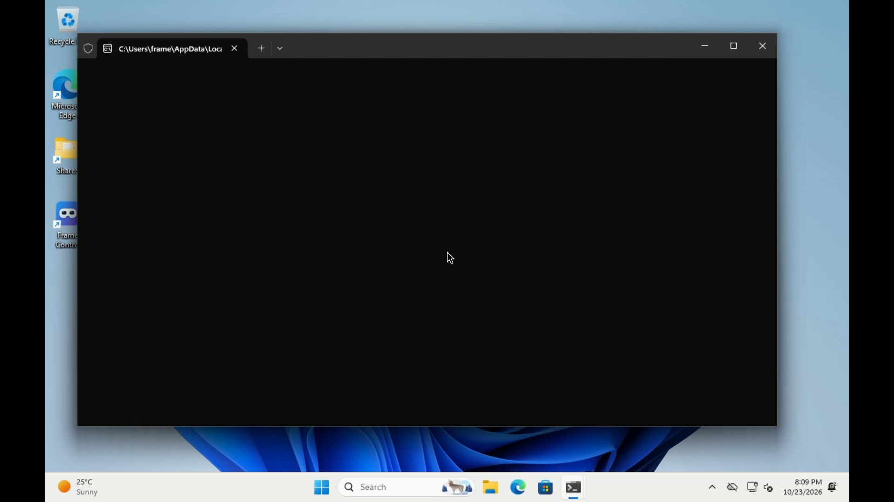

# Windows VM and real Frame test, 2026-10-24

The v0.4.10 installer could enumerate windows/screens and encode a synthetic
Media Foundation stream, but every desktop capture failed at pipeline parsing:
`no property "capture-api" in element "d3d11screencapturesrc"`.
MSYS2's GStreamer 1.28.8 package disables WGC. After the fix, the same installed
bundle captured the actual Windows desktop with Desktop Duplication and sent
H.264 to a real Frame: 219 sent frame records, 215 decoded and drawn before the
snapshot. Individual windows are explicitly unavailable with this bundle.

The base was `e9cbb8fd5555f5cfceeba1babadf2d7d35dcd3be` (`v0.4.10`, origin/main,
including merged #121), in isolated branch `t3/test-windows-vm-headset`.

## Evidence

- [Capture before the fix](windows-vm-2026-10-24/capture-before.json): five
  synthetic H.264 frames and five JPEG frames; zero desktop/window frames,
  with the missing-property error for both codecs.
- [Actual bundled properties](windows-vm-2026-10-24/plugin-properties.json):
  `monitor-handle` exists; `capture-api`, `window-handle`, `show-border` do not.
  [MSYS2 package build](https://github.com/msys2/MINGW-packages/blob/master/mingw-w64-gst-plugins-bad/PKGBUILD)
  sets `-Dd3d11-wgc=disabled`. Upstream
  [installs those properties conditionally](https://github.com/GStreamer/gstreamer/blob/main/subprojects/gst-plugins-bad/sys/d3d11/gstd3d11screencapturesrc.cpp).
- [Capture after the fix](windows-vm-2026-10-24/capture-after.json): the real
  display produces five H.264 and five JPEG frames. Window sources are hidden
  with an explicit reason, and the display selects `capture_api=dxgi`.
- [Raw locked headset session](windows-vm-2026-10-24/headset-session.json):
  Windows helper, Media Foundation encoder, reverse SSH tunnel, production
  panel launcher and shared viewer. The image below was captured from that
  viewer's own X window on the Frame, rather than the VM's console.
- [Windows tests](windows-vm-2026-10-24/windows-tests.txt) and
  [guest system details](windows-vm-2026-10-24/windows-system.txt).

## Host and VM prerequisites

lxso2: Intel Core i7-8700, 12 logical CPUs, VT-x/KVM; Docker 29.1.3 and Compose
2.40.3. Before starting: 31 GiB RAM, 15 GiB available; 147 GiB free disk.
Swap was already full. No other VM or service workload was started or stopped.
Docker listed no Windows VM, and ports 2222/8006/13389 were unused.

The execution sandbox hid KVM and denied Docker/network access. Checks outside
it found `/dev/kvm`, `/dev/net/tun` and the Docker daemon. Direct user access to
KVM was denied, but a disposable Docker container with `--device /dev/kvm`
opened it successfully; no host permissions changed.

Created only `frame-winvm-priority3`, labelled
`frame-control.task=priority3-windows-test`: 4 vCPUs, 8 GiB guest RAM, 32 GiB
growable disk, no restart, 150-second stop timeout. SSH 2222 and console 8006
bind only 127.0.0.1; RDP is unpublished. No GPU passthrough. Image:
`dockurr/windows@sha256:16fd7c39a3e48bb946d29c59dc6015942e5b900a1fa5d7e5552053bfc48ee2ea`
(Windows for Docker v6.06, QEMU v11.1.1).

The container downloaded Windows 11 from Microsoft, with no activation changes.
It took about 16 minutes to reach the first desktop. Guest build 26200.8037,
Red Hat VirtIO GPU DOD driver 100.103.104.30200. The old WindowsProductName
registry field still says Windows 10 Pro; the actual desktop/setup is Windows
11. After installing the app, the 32 GiB disk had about 9.3 GB free.

Official `Frame-Control-Setup-x64.exe` v0.4.10 SHA-256:
`30165bc5aa39f941cacc697d195dc5c30b01ad0b9ffb472da8a18a5220549202`.
Its installer exited 0. The fix replaced only the installed Python/UI files;
the released DLL bundle and bundled Python 3.12.14 stayed in use.

OEM setup added OpenSSH Server, PowerShell and a dedicated public login key;
password authentication is disabled. Its config needed an explicit
`AuthorizedKeysFile C:/ProgramData/ssh/administrators_authorized_keys` before
key login worked. The default informational share was replaced with a private
writable staging share inside this container. These were test-VM setup steps,
not app defects. Host setup files and the stopped VM disk are retained under
`/tmp/frame-winvm-priority3/`; no private keys are committed or printed.
The Frame test key was generated inside Windows and its private key stayed
there. Only its public key was temporarily authorized on the Frame. After
testing, the guest key and scheduled task were removed; `docker stop -t 150`
shut down the dedicated VM. Inspection confirmed `exited`, restart `no`
(container exit 143; logs show the ACPI shutdown signal, waiting for Windows,
and `Shutdown completed!`). The disk is retained
for reuse; the VM is not running.

## Checks

- Baseline PC-focused suite: 24 tests passed, one native class skipped.
- After fix: full Linux unittest suite **1260 tests, OK, 15 skipped**, 144.366 s;
  focused final PC suite **27 tests, OK, one native class skipped**. The C
  controller's frozen 600-state trace ran on Linux.
- Actual Windows installer bundle with the fix: **33 tests, OK, four skipped**
  (no C compiler, Linux PipeWire test, two CI-only x264 tests). The new real
  GObject property probe, host/encoder check and x264-absence check all ran.
- Browser check with the real production HTML/JavaScript and mocked Windows API
  responses: DXGI whole-screen Show remains available, the limitation appears
  once, WGC window sources retain Show, off hides controls, and the limitation
  text is escaped. This used a static asset server, without headset API access.
- `node --test app/test/*.test.js`: passed, three test files.
- `node --test site/test/*.test.mjs`: passed, one test file.
- The first full Linux run inside the sandbox failed (11 failures, 139 errors),
  including loopback socket `PermissionError`. The successful full runs were
  outside that socket restriction.
- An initial guest test archive omitted `apk-catalog`, causing one import
  error; the complete archive produced the 33-test passing Windows run.

Raw local logs: `/tmp/frame-windows-{pc,app,site}-tests.log`,
`/tmp/frame-windows-full-tests-unrestricted.log`,
`/tmp/frame-windows-full-fixed-tests.log`, and
`/tmp/frame-winvm-priority3/`. The committed artifacts above preserve the
capture, Windows test and headset evidence independently of those local files.

## Shared Frame session and cleanup

Read-only checks first: SteamOS 0.5.6, BUILD_ID `20261015.6141207`, battery 99%,
Not charging (another supply reports Full). The lock was free.

Both attempts acquired `/tmp/frame-test.lock` atomically before any key or
viewer changes, and removed only the lock acquired by this task. The first,
35-second attempt failed because the test wrapper sent CRLF script input and
left SSH stdin open. Production already sends script bytes and closes stdin;
correcting the wrapper resolved both. Its key was removed and lock released.

The successful session held the lock **03:09:36–03:10:05 UTC (29 seconds)**.
It used a dedicated `pc-view-priority3` profile and port range 47960–47964,
leaving existing viewers/profiles alone. The app's Windows `PCView` captured
`display:65537`, 1280×800, Light preset (30 fps ceiling), and opened panel
`valve.steam.desktopgame.2001396898`. The viewer reported H.264 software decode,
218 received frames, 215 decoded/drawn before the snapshot (219 sent records).

This mostly idle, roughly ten-second sample reported 19 fps and content delay
p50/p95 51.6/75.2 ms. These are observations, not a performance-target pass.

Cleanup stopped the helper and tunnel, closed the own viewer, removed its two
possible profile paths and log, then removed the exact public-key line. The
`authorized_keys` SHA-256 was identical before/after. A follow-up login from
Windows with that key failed with exit 255. Separate checks found no task-owned
viewer processes, the profile absent, and the shared lock released. Battery
remained 99%; the sampled gamescope focus properties matched before/after.
No reboot, global settings changes, game launch or Steam/SteamVR stop occurred.

## Limits

This verifies a Windows VM's desktop capture, Media Foundation encoding and
real Frame viewer decode/rendering. It does not verify physical-PC hardware
encoding, WGC or individual-window capture, mixed DPI, multiple displays,
physical laser alignment/clicks, keyboard layouts, resize/minimise, busy-scene
performance, bitrate/encoder restarts, or worn-headset comfort. No input was
injected during the real Frame session. The installed app’s Tools navigation was not exercised; its streaming
controller, tunnel and viewer were exercised directly. No independent review was performed.
