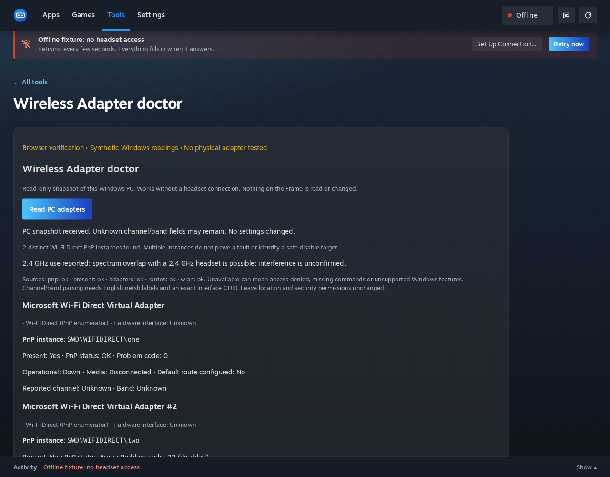

# Windows Wireless Adapter doctor verification, 24 October 2026

PC-only implementation and verification. No Frame was contacted, before or
after 13:00 UTC. No adapters or security settings were changed. This evidence
does not establish a physical Steam wireless adapter fix or RF interference.

## Windows VM

An existing local Windows 11 VM (build 26200), Python 3.12.14 from the installed
Frame Control bundle, ran the isolated suite from a task-specific Downloads
folder:

```powershell
& 'C:\Users\frame\AppData\Local\Programs\Frame Control\resources\python\python.exe' -m unittest discover -s tests -p test_wireless.py -v
```

Result: **15 tests, OK, one skipped** (Node absent). This includes the real
read-only PowerShell inventory and authenticated HTTP handler tests. The app's
connector was never started. Existing test SSH credentials were used only for
the Windows VM; no credentials were copied into the repository.

- [Exact test output](windows-wireless-tests-2026-10-24.txt).
- [Sanitized live inventory](windows-wireless-summary-2026-10-24.json): two
  virtual-machine network devices, with PnP/presence/adapter/route sources
  available. WLAN unavailable; channels/bands remained null. All PnP IDs,
  device names and interface names were removed from this artifact.
- The guest clock was approximately seven hours ahead of the host. `observedAt`
  is retained as returned by Windows, not used to establish test timing.

The first probe used a list of requested default prefixes. A missing IPv6
route caused PowerShell to throw away available IPv4 data. The final query
filters `Get-NetRoute` results instead, and the rerun above confirms routes
are available. No network configuration was changed to make the query work.

## Browser UI and local tests

Production `ui/index.html` ran against a loopback-only synthetic API fixture,
with no connector and no headset transport. Opening/revisiting the tool caused
no wireless query; an explicit click rendered two distinct Wi-Fi Direct PnP
instances and a 2.4 GHz PC interface while the headset state was offline.
Unknown virtual-adapter channels, non-present/disabled status, and unconfirmed
interference remained visible. Checked at 1280 and 640 CSS pixels without
horizontal overflow.



The screenshot uses synthetic readings, not the VM's two Ethernet interfaces.
The yellow synthetic-data label was added by the browser fixture for this
capture; it is not product UI.

Local commands:

```sh
python3 -m unittest discover -s tests -p 'test_wireless.py' -v
node tests/wireless.cjs
python3 -m unittest discover -s tests -v
python3 -m py_compile ui/*.py
node --check /tmp/wireless-index-scripts.js
```

The targeted suite passed 15 tests with the live Windows-only test skipped;
the direct Node run passed all four UI tests. The complete server suite passed
1,423 tests with 16 skips before the additional missing-metadata test; a final
complete run and Windows CI results are recorded in the PR. The syntax check
used inline scripts extracted from the production HTML.

## What remains unverified

No physical Steam dongle, Razer headset, live Wi-Fi Direct session, channel
reading from real wireless hardware, dropout reproduction or recovery action.
The English netsh parser is fixture-tested; localised or denied readings remain
unknown. Windows CI validates query execution on hosted virtual hardware.
There is no adapter disable action because the available evidence cannot
reliably identify a safe extra instance.
