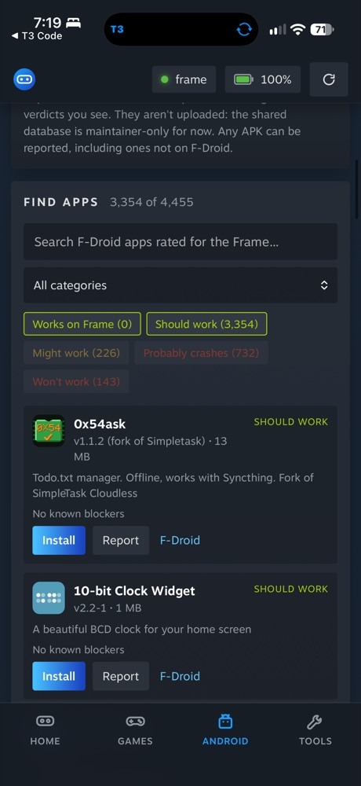

# Frame Control for iPhone

The iPhone (and iPad) app does what the desktop app does, from the phone:
headset view and live video, battery and status, screenshots, Steam games,
Android apps and their display settings, sideloading, files, clipboard,
Flatpaks, and power. Source: [`ios/`](../ios).

## How it works

An iPhone can't run Python or `ssh`, but the Frame can. So the app:

1. connects to the Frame over SSH itself (the [Citadel](https://github.com/orlandos-nl/Citadel)
   Swift SSH library), with its own ed25519 key from the Keychain;
2. copies Frame Control's server and helpers (`ios/scripts/make_frame_bundle.py`,
   under 1 MB) to `~/.cache/frame-control/<version>` on the Frame, once per version;
3. starts `ui/server.py` there with `FRAME_LOCAL=1`. It listens only on the
   Frame's own 127.0.0.1, and it stops when the phone disconnects (`--exit-on-eof`);
4. tunnels to it through the SSH session and shows the same page as the desktop
   app, in a web view. The page carries a fresh key each session, which the
   server requires on every request.

With `FRAME_LOCAL=1`, every `ssh frame COMMAND` the server runs goes to
`ui/local-bin/ssh`, which runs the command on the Frame directly (rsync uses it
as its transport too), so the desktop and phone share one code path. Android
display settings use `podman exec` into each Lepton container instead of adb,
which the Frame doesn't have.

Nothing is left running on the Frame after the phone disconnects; the copied
files stay in `~/.cache/frame-control` (delete it any time).

## Pairing

On the Frame, turn on Developer Mode and set a user password (Steam Settings →
System, then Developer → Set User Password). In the app, enter the headset's
address (`frame.local`, its IP, or its Tailscale name) and that password once.
The app adds its own key to `~/.ssh/authorized_keys` and remembers the Frame's
host key; the password isn't saved. If you already reach the Frame over SSH,
**Or add the key yourself** shows the phone's key to paste into
`authorized_keys`, and connects without a password.

Valve's tap-to-approve devkit pairing isn't used: it only takes RSA keys, and
the Frame's OpenSSH 9.7 rejects the SHA-1 RSA signatures the Swift SSH library
makes.

## What's different on the phone

| Desktop | iPhone |
|---|---|
| Drop files anywhere | Tap **Send to Frame** (or Add a game) and pick files; folders need zipping |
| Screenshots save to `~/Pictures/SteamFrame` | Save opens the share sheet: Save Image puts it in Photos |
| SSH and SFTP open a terminal | They open an app that handles `ssh://` / `sftp://` (Blink Shell, Termius) |
| Steam Link, remote desktop | Open the Steam Link and Windows App apps |
| Sleep, restart, shut down ask in a terminal | The page asks for the Developer Mode password |
| Compatibility reports kept on the computer | Kept on the Frame (`~/.local/share/Frame Control`) |

## Building

```sh
cd ios
xcodegen generate          # after changing project.yml
open FrameControl.xcodeproj
```

The build packs the Frame bundle from the checkout, so the phone always runs
the page and server from the same commit. Running on a phone needs your own
signing team in Xcode (Signing & Capabilities).

## TestFlight

Join the [Frame Control beta](https://testflight.apple.com/join/9xjW91g6),
install Apple's TestFlight app, then tap **Install** or **Update** next to Frame
Control. Internal account testers can also use their invitation. The first
working phone build was version 0.1.0, build 202610140516, uploaded on
2026-10-14. On 2026-10-16, build **202610160824** was uploaded and approved for
internal and external testing. App Store Connect confirmed both builds were in
the external **Public Beta** group, with its public link enabled and a limit of
50 testers. The new build declares the encryption-compliance answer in the app
and preserves the previous build's exact server bundle.

### Upload a build

You need Xcode, XcodeGen, a paid Apple Developer Program team, an App Store
Connect app record for `com.saphid.framecontrol`, and an App Store Connect team
API key with the signing access your release setup needs. This Mac relies on
Apple's cloud-managed distribution certificates: an **App Manager** key was
rejected with `Cloud signing permission error`, so this setup needs **Admin**
access. A setup with a local distribution signing identity may be able to use
a narrower role. Create the key under **Users and Access →
Integrations → App Store Connect API**. Download it directly to
`~/.appstoreconnect/private_keys/AuthKey_<KEY_ID>.p8`, outside the repository,
and restrict it to its owner (`chmod 600`). Apple allows one download. Keep
the private key out of chat, screenshots, logs and Git.

From the repository root:

```sh
ASC_KEY_ID=YOUR_KEY_ID \
ASC_ISSUER_ID=YOUR_ISSUER_UUID \
ASC_KEY_PATH="$HOME/.appstoreconnect/private_keys/AuthKey_YOUR_KEY_ID.p8" \
TEAM_ID=YOUR_TEAM_ID \
  ios/scripts/testflight.sh
```

The script regenerates the Xcode project, archives with automatic signing,
checks the archived build number, and uploads to App Store Connect. `TEAM_ID`
defaults to this project's team, `NJZUMEA4BN`. `BUILD_NUMBER` defaults to UTC
`YYYYMMDDHHMM`; wait for a new minute between uploads, or supply a unique,
higher build number. The archive, export options and export output are under
`ios/build/testflight/<BUILD_NUMBER>/` (ignored by Git).

Build from a reviewed, clean checkout. The build packs the server, web pages
and helpers from the current checkout, including uncommitted changes; it does
not limit the bundle to the last commit.

An upload succeeding means Apple received the build. Wait for it to finish
processing in **App Store Connect → Frame Control → TestFlight** and check
that it is ready for testing. `ios/project.yml` declares
`ITSAppUsesNonExemptEncryption: false`, so each generated app declares that it
uses no non-exempt encryption, matching the previous builds' export-compliance
answers. Reassess that declaration if the app's cryptography changes.

To replace a key, create and securely download the replacement, verify that it
can access this app, then revoke the old key in Users and Access. Update the
upload environment to use the replacement. Revocation does not remove an
already uploaded TestFlight build from testers' phones.

### Add testers

**Internal:** add an existing App Store Connect user with an eligible role to
an internal testing group, and add the build to that group (or enable automatic
distribution). New account users must first accept their account invitation.
Internal testing grants App Store Connect access; use external testing for
people who only need to try the app.

**External:** create an external testing group, complete Beta App Information
and review contact details, add a build and its **What to Test** notes, then
submit it for TestFlight App Review when required. Use
<https://framecontrol.fun/privacy/> for the privacy policy and
<https://framecontrol.fun/feedback/> for feedback. Review notes must explain
that the app requires a Steam Frame with Developer Mode enabled and a user
password; do not provide your own headset credentials to reviewers. Apple may
need a way to evaluate features that require the hardware.

After Apple approves the build for external testing, enable the group's public
link and choose a tester limit. Share that link to let testers join without an
App Store Connect account. Creating a group alone does not make a build public.
Do not describe the link as ready until the approved build is in the group and
the link is enabled.

## Verified


In the iOS Simulator (iOS 26.5) against a real Frame, 2026-09-27: the app connected
with its key, copied the bundle over SFTP, started the server on the Frame and
showed all four tabs with live data. In the app's web view, Capture returned a
headset still and Live played H.264 video at 31 fps (WebCodecs works in
WKWebView). Through the app's tunnel: status, games, Steam library, Android apps,
screenshots, a file upload (checked on the Frame), a background install job, and
the power password check (a wrong password is refused). The server on the Frame
exits within seconds of the app closing.

Against Valve's own Steam Frame OS (SteamOS 0.3.0 build 20260922.5152327, the
`rootfs-A` partition of the Frame recovery image, run with its own sshd; see
[tests/frame-container](../tests/frame-container)), and a Holo Core stand-in:
pairing with the password (key added with the right
permissions, host key pinned, password stored nowhere), the power password
check (a wrong or missing password refused; the right one reaches `systemctl`),
a changed host key refused with "Pair with the Frame again", and a wrong
pairing password reported the same way.

Also verified in the Simulator against the Frame (2026-09-27): the setup screen
found the Frame by itself over Bonjour (`frame · 192.168.1.237`); a paired app
waiting for a sleeping Frame connected 4 s after it answered; an upload from the
app's web view landed in `~/Downloads`; the share sheet offers Save Image
(needs `NSPhotoLibraryAddUsageDescription`, now declared); an install link opens
the confirm dialog and downloads nothing until Install; Steam Link without the
app installed opens its App Store page.

Things iOS asks the first time: **Local Network** (tap Allow, or the app can't
see the Frame), and **Paste** when you send the iPhone's clipboard (tap Allow
Paste, or set Settings → Apps → Frame Control → Paste from Other Apps → Allow).
Sending text to the Frame's clipboard needs the desktop panel open in the
headset, as on the desktop app.

On a physical iPhone, 2026-10-14: Alex reported build 202610140516 was working
after pairing and trying the password visibility button. A server process
started by the phone and its SSH key on the Frame confirmed the connection.
This was a setup/connection smoke check; it did not verify every app feature.

On a physical iPhone 16 Pro running iOS 27.2, 2026-10-16: the same build launched
and automatically reconnected to the Frame. A device screenshot showed the
green connection indicator, 100% headset battery and the loaded Android
catalog. This confirms connection and rendering, not status refresh or actions
inside the app. A separate signed automation runner was installed and passed
its health check, but iOS then refused activation with `SBMainWorkspace: Locked`;
the phone must be unlocked for the remaining interactive checks. A later resume
attempt at 20:09 Australia/Sydney found it locked again before runner startup
(`passcodeRequired: true`). No new feature checks completed; the task's
automation session was closed, and the installed app was preserved.



### Physical-phone follow-up checklist

- Confirm battery/status data updates and the Steam games list loads.
- Capture a headset still, save it through the share sheet, then play live video.
- Send a small, disposable file and check its contents on the Frame; remove the
  test file afterwards.
- Send test text to the Frame's clipboard with its desktop panel open.
- With an Android app running, change and restore its display settings.
- After saving headset work, deliberately test sleep, restart and shut down.

These full feature checks remain pending on a physical phone. Android display
changes through podman and real sleep/restart/shut down also remain unverified
by the Simulator checks above.

Debug builds have Simulator test hooks (`FRAME_TEST_HOST`, `FRAME_TEST_PAGE`,
`FRAME_TEST_JS`, and the tunnel URL in the app's Caches folder); release builds
don't.
