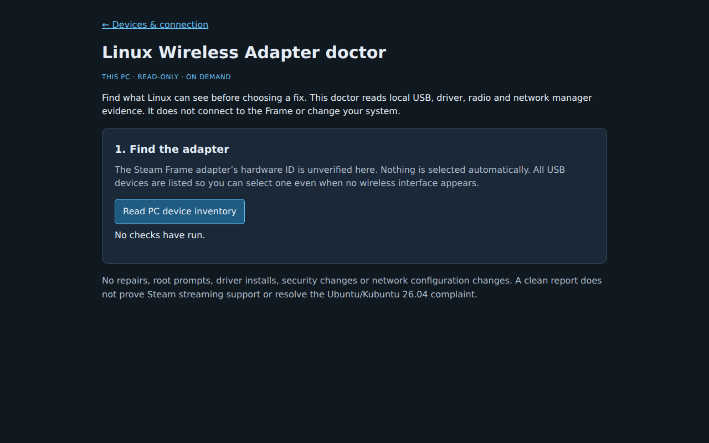

# Linux Wireless Adapter doctor



On the **Linux PC**, open **Settings → Linux Wireless Adapter doctor**, or
**Devices & connection → Linux Wireless Adapter doctor**. It works without a
connected headset. Choose **Read PC device inventory**, select the intended
USB device or wireless interface, then **Check selected device**. Nothing runs
until requested. Re-read the inventory after reconnecting a device.

From a source checkout, the same collector is available without starting the
app or its headset connection workers:

```sh
python3 ui/frame_wireless_doctor.py
python3 ui/frame_wireless_doctor.py --device net:wlan0
python3 ui/frame_wireless_doctor.py --device usb:1-2 --json > adapter-report.json
```

Use a selector actually listed on your PC. No device is selected automatically.
All USB devices are included, including hubs and devices without a network
interface. A product label, observed VID/PID, or a single available interface
**does not identify Valve's adapter**. There is no trusted adapter ID table in
this feature. Compare inventory before and after reconnecting the intended
adapter when safe. For a USB device exposing multiple wireless interfaces,
select the specific interface for radio/manager evidence.

## Evidence and limits

- **Presence and binding:** `/sys/bus/usb/devices` and `/sys/class/net` correlate
  USB ancestry, wireless interfaces, driver links and module links. An absent
  interface does not establish which driver should be installed. A missing
  module link may mean a built-in driver. A bound driver does not prove Steam
  streaming support.
- **Permissions and udev:** `udevadm info --query=property` supplies a small
  allowlist of driver, ID and tag fields. If available, the report includes USB
  node mode, owner/group IDs and the current user's read/write access. Direct
  USB access is not necessarily required by kernel networking; a restrictive
  node alone is not diagnosed as the cause. No udev rules are installed or run.
- **Radio blocks:** read-only WLAN rfkill sysfs entries are matched to the
  selected interface's PHY name. An unrelated block cannot establish that
  this adapter is blocked. Unavailable or unmatched entries remain unknown.
- **Channel/band:** `iw dev IFACE info` provides the current channel and
  frequency where reported; `iw phy PHY info` supplies enabled frequencies.
  An idle interface may have no current channel. These observations do not
  establish the channel used by a Steam streaming session, supported regions,
  or the correct regulatory setting.
- **Network managers:** visible `/proc/*/comm` process names show
  NetworkManager, iwd and wpa_supplicant. `nmcli` reads only the selected
  interface's general state, managed flag and driver. NetworkManager can use
  iwd or wpa_supplicant as its backend, so coexistence is not itself a conflict.
  If both backends are visible, the report suggests checking who owns this
  exact interface. It does not claim a confirmed conflict or stop services.
  Restricted process visibility and unverified backend ownership are explicit.

Every command uses fixed read-only arguments, no shell, closed stdin and a
three-second timeout. Optional tools are not installed automatically. Missing
tools, denied reads, disappearing devices, and restricted VM/container hardware
visibility remain unknown. A successful report is a snapshot, not a hardware
health certificate. CLI exit 0 means collection is supported, not that the
adapter works; unsupported platforms/headset-local mode return 2, as does an
invalid/stale selector. JSON has schema version 1.

The doctor never uses SSH, scans nearby Wi-Fi networks, opens a connection to
the Frame, escalates privileges, loads drivers, changes security settings,
changes channels, unblocks radios, changes network settings, or restarts
services. Run it as your ordinary user, never with sudo. The app hides the
entry on macOS, Windows and phone sessions; its API refuses collection in
headset-local (`FRAME_LOCAL=1`) mode. The source CLI is intended only for the PC.

Reports stay local unless you explicitly save, copy or share them. Exported
fields include observed USB IDs/product labels, interface names, driver names
and permission metadata. USB serials, Wi-Fi names, MAC/IP address fields,
credentials, process arguments and raw command output are not exported. Review
the report before posting it: hardware labels and local paths can identify
parts of your setup.

## Motivation and shipped comparison

[The 23 October 2026 complaint](https://x.com/ExpressGinga81/status/2113457683143741720)
says the Wi-Fi dongle does not work on Ubuntu/Kubuntu 26.04 while SteamVR works
under Wayland. It supplies **no adapter VID/PID, driver, logs or established
cause**. This feature helps gather that missing evidence; it does not claim to
fix that complaint or certify Ubuntu/Kubuntu 26.04 support.

Shipped **v0.4.18** has local network/gateway discovery in `frame_network.py`
and headset connection management, but no local USB/driver/rfkill adapter
report or adapter diagnostic UI. The existing `frame-doctor.sh` diagnoses the
headset through SSH and is a different tool. This doctor never calls it.
General SteamOS 3.9.5 / Frame OS 0.5.6 compatibility and OS backend transition
notes are a separate workstream; this feature relies on observed PC evidence
rather than an OS-version assumption.

## Verification

```sh
python3 -m unittest discover -s tests -p test_wireless_doctor.py -v
python3 -m unittest discover -s tests
```

Tests use an explicitly synthetic USB `1234:5678`, sysfs trees, command replies
and loopback HTTP. They cover an unbound USB device, module binding, multiple
interfaces, PHY-matched and unrelated rfkill entries, channel parsing, manager
coexistence, missing/denied commands, stale/injected selectors, export field
filtering, authentication and refusal to probe in headset-local mode. The
HTTP tests instantiate the handler without starting headset workers.

Linux host collection was exercised on kernel `6.8.0-139-generic`: an existing
PC interface was visible with its `iwlwifi` binding and unblocked PHY; `iw` and
`nmcli` were absent and reported as unavailable. This is **not a physical Steam
Frame Wireless Adapter test**, an Ubuntu/Kubuntu 26.04 test, or a headset test.
No Frame access is part of this work.
