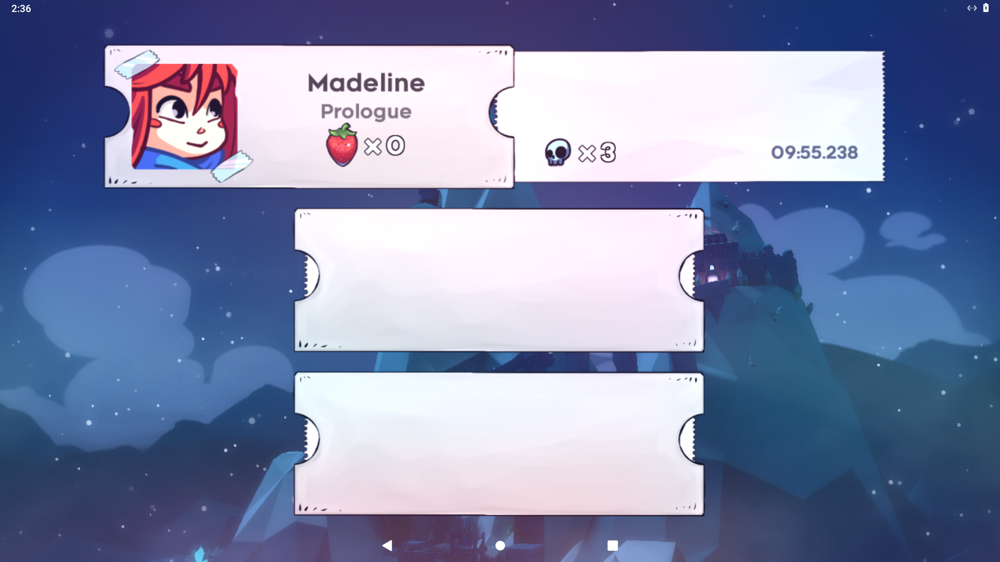
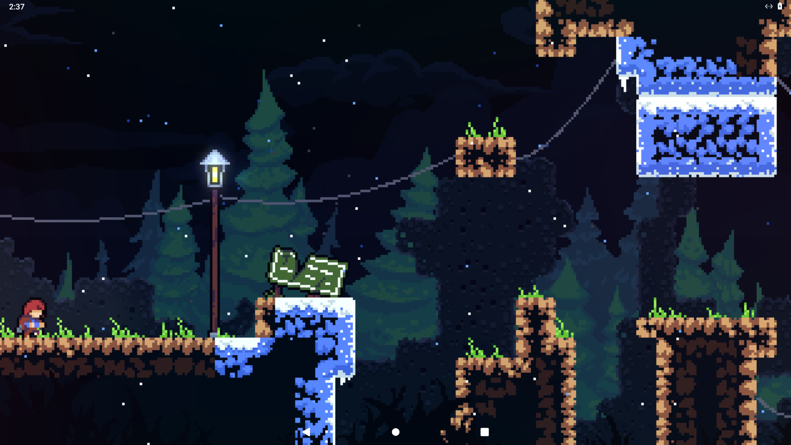
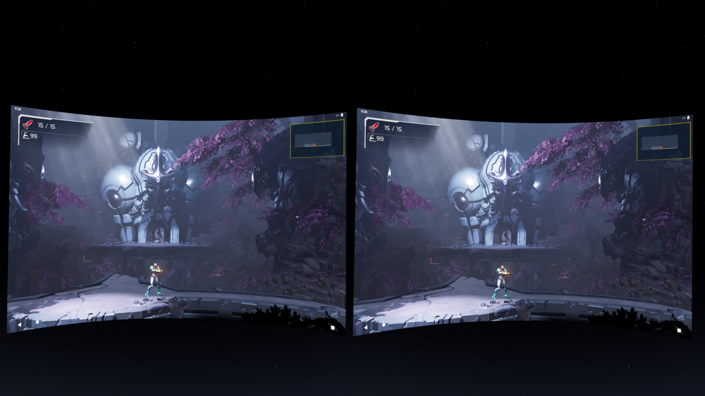

# NxNative on Steam Frame

Implemented and tested on the physical Steam Frame starting on 2026-11-05.
Metroid Dread 2.1.0 and Celeste 1.4.1.1 reach visible gameplay in persistent
Lepton flat panels. Build, staging, input and host patches are saved in this
repository. Compatibility remains experimental and specific to each game build.

## Follow-up validation: 2026-11-06

These observations come from remote tests on the physical Frame. Injected
keyboard and touch input do not establish Frame controller button/axis feel or
worn-headset comfort; those remain untested for these follow-ups.

| Game / route | Observed on Frame | Still to verify or resolve |
|---|---|---|
| Metroid Dread 2.1.0 / NxNative | Controllable gameplay, video/audio and the existing saved checkpoint; detailed evidence below | Later save-station write/reload and physical controller/comfort checks |
| Celeste 1.4.1.1 / NxNative | Visible gameplay, remote movement/jumping, audio and cold save reload; Continue restores gameplay and movement | Regression on the final shared renderer changes remains pending |
| Balatro / separate LÖVE runtime | Actual gameplay through remote touch input and nonzero output audio | Continue after a cold restart and restoration of an in-progress run |
| Super Mario Bros. Wonder / NxNative | Backgrounds, interface and coins render; the foreground and player remain black | Foreground rendering; no complete gameplay compatibility claim |
| Pokopia / NxNative | Experimental bring-up only | Gameplay compatibility remains unverified |
| Super Mario Odyssey / NxNative | Available game inputs are encrypted; no matching keys were found in the inspected private inputs | Preparation is blocked on the user's own usable inputs and keys; not tested as working |

Prepared game APKs, ROMs, extracted assets, shader bytecode, keys and private
source catalogs remain outside the repository and release bundles. Frame Control
ships the tools and profile metadata; users add their own sources and assets.

### Celeste cold save reload

**Save and Quit** created `0.celeste` (14,534 bytes) and `settings.celeste`.
After stopping and launching the persistent instance through the app's Android
backend, without diagnostic environment overrides, the slot retained **Prologue,
3 deaths and 09:55.238**. Continue loaded visible gameplay, and remote movement
worked after reload. No save files were edited. The
[follow-up receipt](evidence/nxnative-frame-followup-2026-11-06.json) records the
save digest and screenshot digests.





[Movement after reload](evidence/nxnative-frame/celeste-reloaded-input-2026-11-06.png)
changed the player's visible position. This test used the runtime before the
shared shader image-view patch. It does not establish regression results for the
final shared renderer or an exact release candidate. After the cold Continue, a
one-second capture of the Lepton output monitor contained nonzero 48 kHz stereo
audio (signed 16-bit peak 3,107; RMS 778.24). No microphone was recorded.

The earlier PA-Agent and initial Frame results below describe their original
test sessions. They are retained as provenance rather than substituted for these
follow-up observations.

## Recommendation

Start with **the existing Android/Vulkan fork in a persistent Lepton instance**, using Metroid Dread 2.1.0. It keeps native ARM64 execution and reuses a Vulkan backend that already exists. Build a native Linux host later if measurements or Lepton limitations justify it.

This is substantially less work than porting the current Apple host directly. An IPA cannot run on SteamOS: its Mach-O executable, Apple frameworks, thread-slot layout and Metal shaders all target a different platform.

The useful discovery is [the Android port proposal, upstream issue #733](https://github.com/seedds/nxnative/issues/733). Its author reports Metroid Dread, Mario Odyssey and Hollow Knight playing on a Mali Android handheld. Those are **author reports on another device**, not Frame validation. I inspected the fork's actual source as well as its proposal.

## Sources and versions

| Source | Inspected version / evidence |
|---|---|
| [NxNative upstream](https://github.com/seedds/nxnative) | `56bafa974a18382fc53dac20080d7fce3d815a1b` |
| [Android fork, branch `android`](https://github.com/joaquinsandoval2307/nxnative/tree/android) | `32b0ef2c5408e1e32cb5c0bc49f84d1e63653dc3` |
| PA-Agent's Mac checkout | `/Users/saphid/projects/nxnative`, `65501fbbaf8526f7aab0a1edd028135888590f8e` |
| PA-Agent's previous results | `/Users/saphid/projects/PA/artifacts/nxnative-iphone-duo-2026-11-03/` and `nxnative-more-games-2026-11-03/` |
| Live Frame inspection | SSH reads of OS, page size, memory, Vulkan capabilities, installed development headers and Lepton availability; [receipt](evidence/nxnative-frame-feasibility-2026-11-05.json) |
| Existing Frame integration | [APKs and persistent Lepton apps](apks.md), [native Linux sideloading](sideloading.md), [panel architecture](how-the-frame-works.md) |

The Android fork is an older, divergent codebase. Treat its host, rewriter, profiles and shader exporter as a matched baseline for the first experiment. Do not combine its binaries or shader outputs with current upstream caches without checking their formats and assumptions.

## How NxNative works

The Switch game already contains AArch64 machine code. NxNative rewrites the instructions that depend on the original operating environment, loads and relocates its modules, and supplies Horizon system calls and SDK services. Most game instructions execute directly on the host CPU. This still requires substantial operating-system and graphics compatibility work.

The Apple route is:

```text
Game inputs → extract / apply update → NSO rewrite + game profile
                                      ├─ ARM64 code → Horizon HLE host
                                      └─ NVN shaders → SPIR-V → MSL / Metal
```

The proposed Frame route is:

```text
Existing game inputs → Android-specific NSO rewrite + SPIR-V export
                     → per-game ARM64 APK + game data
                     → Frame Control persistent Lepton instance
                     → native ARM64 execution + NVN → Vulkan → Turnip
                     → ordinary flat game panel in SteamVR
```

The Android container does not require x86 translation. This route produces a flat game in the headset; stereoscopic rendering, head tracking and VR conversion are separate work.

## What the Frame actually provides

Live Linux-side inspection found:

| Capability | Observed |
|---|---|
| OS / CPU / pages | SteamOS build `20261022.6153909`, `aarch64`, 4,096-byte pages |
| GPU | Turnip Adreno 750, Mesa `26.3.0-devel (git-e07916b45f)` |
| Vulkan | Device API `1.4.362`; instance API `1.4.309` |
| Memory | 15,662 MiB physical memory reported; shared with the OS and VR compositor |
| Relevant features | BC texture compression, geometry and tessellation shaders, timeline semaphores, descriptor indexing, scalar block layout, buffer device address |
| Subgroups | Default 128; supported size range 64–128 |
| Numeric limits | `shaderFloat64=false`, `shaderInt64=true` |
| Development / runtime | Vulkan and SDL2 headers, clang, and Lepton installed |

These were the initial Linux-side observations. The subsequent NativeActivity probe independently confirmed Android 11 / API 30, 4,096-byte pages, Turnip Adreno 750 / Vulkan 1.4.362, BC support, no FP64, int64 support and subgroup size 128 inside the actual game process.

## What we can reuse

The Android fork already has:

- [`DM_PATCH_TP=android`](https://github.com/joaquinsandoval2307/nxnative/blob/32b0ef2c5408e1e32cb5c0bc49f84d1e63653dc3/dm/tools/patch_nso.py), which redirects guest thread state through bionic's `TLS_SLOT_APP`. Its loader checks the target recorded in module metadata. Apple's rewritten code is not interchangeable with it.
- A [Vulkan replay backend](https://github.com/joaquinsandoval2307/nxnative/blob/32b0ef2c5408e1e32cb5c0bc49f84d1e63653dc3/dm/android/src_vk/nvn_vk.c), Android NativeActivity presentation and gamepad input, AAudio output, MediaCodec H.264 decoding, and Linux/bionic implementations of many Apple API calls.
- A [SPIR-V exporter](https://github.com/joaquinsandoval2307/nxnative/blob/32b0ef2c5408e1e32cb5c0bc49f84d1e63653dc3/dm/android/tools/spv_android.py) that intercepts NxNative's shader chain before its Metal output is discarded.
- Per-game APK packaging, saves, pipeline caching and a CPU-only/null graphics mode.

Frame Control already installs an APK as its own persistent Lepton app and creates its Steam shortcut. This supplies the library entry, separate panel, lifecycle and persistent Android data. Use that route instead of installing into the disposable Lepton Development instance.

## Changes and checks specific to Frame

1. **Make the build consistently support API 30.** The fork's native Makefile defaults to API 30 and its manifest declares minimum 30, but `make_apk.py` invokes D8 with `--min-api 33`. Align D8 with 30 and check all Java/native API use. The manifest's target SDK 33 alone is not an installation blocker. Parameterize its hard-coded SDK/build-tool/JDK paths; PA's Mac has NDK `27.1.12297006` installed, and the pinned fork now compiles with it.
2. **Validate execution in the app process.** Start with the fork's `dm/android/tests/t_tls_slot.c`: thread-slot ownership, isolation across threads, calls into libc/Vulkan and executable memory. Also exercise the same checks under NativeActivity; a shell-context success alone does not prove app-domain permissions. Audit the rewriter's below-SP scratch accesses and signal handling for Linux/Android rather than assuming Apple's red-zone rules hold.
3. **Avoid the missing file picker.** The fork bundles small games into the APK, but spills large games into a `-datos.zip` selected with `ACTION_OPEN_DOCUMENT`. Lepton has no document picker. Use a fully bundled test game where it fits, or stage a verified data archive into that game's persistent instance and add a direct importer with an atomic completion marker. Keep versioned game data separate from saves. The current `--deploy` assumes a normal ADB device; it needs routing to the selected Lepton instance. Lepton exposes only selected host paths, so a random host directory is not sufficient.
4. **Establish Vulkan correctness before optimization.** Query and enable features in Lepton, validate SPIR-V and descriptor layouts, and exercise depth/origin conventions, synchronization and swapchain recreation. The Linux device has no FP64 and no 32-lane subgroup size; audit shaders that assume a Maxwell warp. A `.spv` extension alone does not prove a module matches the backend's bindings or supported features.
5. **Then use Adreno's capabilities.** The fork unconditionally expands BC textures for Mali. Retain that fallback initially; add native BC sampling only after checking the exact formats and usage flags on the Android device. Its conservative copies, broad barriers and `GENERAL` image layouts are useful bring-up choices, with performance work remaining.
6. **Check real controls and lifecycle.** Start with an ordinary gamepad. Verify Frame-controller button/axis delivery through Lepton separately. Test sound, focus changes, surface loss, suspend/resume, stopping from Steam, and a save surviving a full restart. No phone-only service should be required for startup.

The fork documents missing indirect draws, buffer textures, geometry/tessellation stages and AAC decoding. Hardware support for a feature does not implement it in the replay backend. Its Android build also does not compile upstream's Apple Vulkan-game or OpenGL-game backends: Hades and Balatro are not automatic beneficiaries of this NVN port.

## PA-Agent findings that change the starting point

- **Wonder 1.2.1:** PA's `device-verification.json` records an iPhone launch and visible title screen with about 25 seconds of logging. It explicitly says gameplay was unverified. This establishes a useful Apple reference, not Frame compatibility or a gameplay benchmark.
- **Metroid Dread 2.1.0:** PA's `game-build-id-verification.json` matches all three modules to its profile: `main=646761f643afebb379edd5e6a5151af2`, `subsdk0=507f19d1240d09d00992248e8a0fd77e`, `sdk=2d369d9999e3e10e665106f840ffff9b`. The inspected Android fork names those same builds. It is the best initial candidate because the Android author also reports gameplay for this exact version.
- **Celeste:** PA has matching 1.4.1.1 inputs, and current upstream documents only 26 shaders. The pinned Android fork has no Celeste profile, so it needs porting and shader-export work before it can be a Frame follow-up.
- **Balatro:** PA has prepared inputs, but its OpenGL graphics route adds work beyond the inspected Android NVN backend.
- PA's final Celeste/Balatro/Dread runtime batch explicitly reports **no visually verified gameplay input**. Foreground interruptions and an existing launcher process limited those tests. Do not convert build/install success or the absence of red log lines into a gameplay claim.

## Implementation order and completion gates

| Stage | Work | Evidence required to move on |
|---|---|---|
| 1. Reproduce baseline | Pin the Android fork, align API/tool paths, run execution and Vulkan capability checks in Lepton | App-process native-code/thread-state checks pass; actual Android GPU features recorded |
| 2. Dread first frame | Rewrite the matching Dread modules with `DM_PATCH_TP=android`; export shaders; build APK; use persistent Frame Control installation | Rendered game image plus logs; identified unsupported operations; no game data bundled into the source repository |
| 3. Playability | Exercise input, audio, save/restart, focus and suspend/resume | A real gameplay route and a restored save; distinguish measured frame pacing from a counter overlay |
| 4. Frame product integration | Data importer, useful errors, progress reporting, package/update identity, optional BC path | Repeatable build/install/play/update flow through Frame Control |
| 5. Broaden support | Celeste, then Wonder and other profiles; address missing backend features as encountered | Per-game, per-build results with screenshots and sustained measurements |

Build commands come from the fork's [Android README](https://github.com/joaquinsandoval2307/nxnative/blob/32b0ef2c5408e1e32cb5c0bc49f84d1e63653dc3/dm/android/README.md). They need a separate Android rewrite directory (`patched_android`), a shader package/cache matching that fork, and the matching title profile. Existing Apple `.metallib` files and patched modules cannot be substituted. Its current exporter still runs the Metal build chain to recover SPIR-V, so the Mac build environment remains useful even though the resulting game uses Vulkan.

## Native Linux option

A native SteamOS executable could eventually remove the Android menu/container/data-import boundary. Reuse the Android fork's Vulkan backend and portable host work; replace NativeActivity with SDL/Wayland or X11 presentation, AAudio with SDL/PipeWire audio, and MediaCodec with a Linux decoder. Add a glibc-compatible guest-state accessor: bionic's `TLS_SLOT_APP` is not a glibc contract. Port the remaining loader, ELF sections, assembly, signal contexts, scheduling and memory aliases deliberately.

Launch that executable through Frame Control's existing native ARM64 sideload/panel path. A custom OpenXR renderer is unnecessary for a flat game panel. Upstream [issue #538](https://github.com/seedds/nxnative/issues/538) requests Linux/aarch64 support; its request is not an existing Linux implementation.

Choose this larger route when Lepton produces a measured blocker or when maintaining one portable Linux runtime becomes the product goal. The first milestone remains one correct game on the actual headset, with explicit evidence, before promising wider compatibility or a frame rate.


## Implemented Frame adapter

The reproducible build and staging tools are in [frame/nxnative](../frame/nxnative/README.md).
The saved patch targets the pinned Android fork; PA's Apple source and game builds
are left intact. Runtime files stay in a separate build workspace at
`/Users/saphid/Games/NxNativeFrame` on the Mac.

Verified so far:

- Native ARM64 Android host, Android-specific main/subsdk0/sdk rewriting, signed
  API 30 APK, and a second build through the saved workflow all succeeded.
- All 1,010 SPIR-V shaders passed Vulkan 1.3 validation. The generated bindings
  have no unknown kinds. The shader instructions use neither FP64 nor subgroups.
- The actual game's NativeActivity process passed executable-memory and
  thread-slot isolation checks across 16 threads. Lepton exposes Turnip Adreno
  750 / Vulkan 1.4.362, BC compression, no FP64 and a subgroup size of 128.
- Persistent Steam library installation uses package
  `com.nxnative.t010093801237c000`, instance `2843545929`, shortcut `2439313234`.
- Staging checks every file before publishing a versioned dataset pointer, and
  keeps saves in separate private app data. Bad checksums and interrupted-stream
  tests preserve the old selection and saves.
- A physical-headset import test exposed Android 11 toybox truncating PAX long
  filenames. The importer now uses GNU long-name records, tested successfully
  through its actual streaming path on the Frame. The rejected upload never
  became the selected dataset.

The probe's first run intentionally preceded game-data staging: it passed, then
module loading failed because the modules were not present yet. The adapter now
also supports `DM_FRAME_PROBE_ONLY=1` for a probe without loading game modules.

[Runtime receipt](evidence/nxnative-frame-runtime-2026-11-05.json) and
[measured shader toolchain patch](evidence/nxnative-frame-toolchain-2026-11-05.patch).


## Physical-headset runtime results

Dread's title, file selection, narrative, opening 3D cinematic and opening Artaria
room rendered on the Frame. Injected Linux input through the selected Lepton
instance's real keyboard FIFO visibly controlled movement and release, camera
scrolling, jumping and ledge traversal, shooting, missiles, melee, sliding, free
aim, simultaneous stick/buttons and combat damage. A ceiling obstacle was shot
and destroyed. This establishes actual gameplay, beyond a title-screen launch.



The main gameplay session presented 74,400 frames and 12,780,951 draws with zero
backend-reported dropped draws, over 20 minutes including cinematics and idle
time. A stationary opening-room sample logged median frame intervals around
16.7–16.8 ms and p95 around 18.5–18.9 ms. Opening 3D cinematics ran near 30 fps.
These are runtime counters, not a sustained active-gameplay or comfort benchmark.

A capture of the game's Lepton output monitor contains 3.072 seconds of nonzero
48 kHz stereo audio (signed 16-bit peak 15,093; RMS 3,583). This verifies sound
reaches the audio server; no microphone was recorded. An initial callback warning
recovered, and later callback windows reported no underruns.

Two runtime fixes were necessary:

- The old movie ring gate could continue after a three-second timeout while the
  dispatcher still referenced holders the caller then freed. The patch backports
  explicit guest runnable state and transitive wake handoffs from upstream, with
  native codec locks/conditions marked as blocking boundaries. Dread retains its
  profile-enabled check for workers that are already runnable; omitting that
  check passed gameplay but reproduced a MultiWait crash at the title-video loop.
  The rebuilt app passed the title loop and loaded the saved checkpoint.
  Other games keep the fork's original scheduling policy. The 28-case native
  regression suite covers delayed dispatch, real wake SVCs, chained wakes,
  exclusions, native locks and the already-runnable-worker case.
- Lepton's Vulkan surface offers only inherited composite alpha. A fullscreen
  final pass writes alpha=1 with RGB writes disabled, so the game panel stays
  opaque without changing game blending. The pass runs only when OPAQUE composite
  alpha is unavailable. Both embedded shaders pass SPIR-V validation.

The slot-1 Normal save at **00:03:33** and settings survived APK replacement and
a full persistent-container stop/relaunch. Continue restored the opening-room
checkpoint; movement and shooting worked again on the final build. Save-file
SHA-256 values are recorded in the runtime receipt. Saving and reloading at a
later save station has **not** been verified.

Remaining checks: physical Frame-controller axes/buttons, worn comfort, broader game coverage. Android status/navigation bars remain
visible. The backend logged vertex-attribute 6/7 format-0 warnings during 3D,
although it reported zero dropped pipelines/draws in the exercised route. No
native BC-texture optimization or native Linux host was added.

The app remains installed as **Metroid Dread (NxNative)** in Steam. Diagnostic
environment overrides are removed after testing. Game data, APKs and signing
keys remain outside the repository; only screenshots and text receipts are saved.


## Extended remote lifecycle checks

On 5 November, Android Settings was brought to the foreground and the existing
NativeActivity brought back. The PID stayed the same and movement worked after
returning. A real system suspend was then armed with an RTC wake timer: the
system journal confirms suspend at 09:58:15 UTC and resume at 09:59:04 UTC.
Dread retained PID 1021, returned to rendered gameplay, and responded to movement.
The game was loading the saved checkpoint just before this suspend. This checks
remote recovery, not the wearer-visible transition or controller reconnection.

The user chose to continue remotely. Physical controller feel, controller axes
and buttons, and worn comfort remain unverified. A later save-station write and
reload also remain unverified; the initial checkpoint and settings persistence
test is recorded above.
